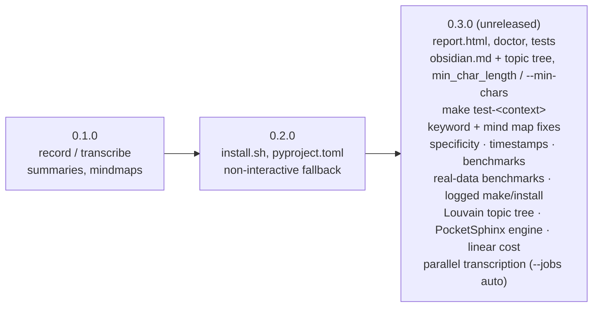

# Changelog

## [0.3.0] — Unreleased

### Added

- `obsidian.md`: Obsidian note with a `> [!summary]` callout, `[[wiki-links]]` for the
  top keywords and a collapsible transcript (`writers.write_obsidian_note()`)
- `min_char_length` parameter for `textproc.summarize()` (default `20`) to keep short
  fragments out of summaries; `textproc.extract_summary()` alias
- `## Topics` section in `obsidian.md`: nested `[[wiki-links]]` built by `textproc.topic_tree()`
  (term subsumption), so long multi-topic recordings such as group chats become a tree of topics
  that links recordings together in an Obsidian vault
- `--min-chars N` option for `record` and `transcribe` (default 20, `0` keeps everything): drops
  short fragments from the summary, mind map and topic tree
- Timestamps in the `obsidian.md` topic tree: each topic lists where it comes up in the recording
  (first 3 Whisper segment starts, `textproc.attach_timestamps()`)
- `benchmarks/` (`make bench`, `make bench-quick`): speed and topic-quality benchmarks on corpora with
  known topics, written to `benchmarks/RESULTS.md` with charts; includes a templated group-chat generator
  where only topic nouns change and generic words, names and weekdays are shared (the realistic case)
- Real-data benchmarks (`make bench`): 106 Wikipedia articles, 200 Usenet posts (20 Newsgroups) and 233
  State of the Union addresses, downloaded at pinned versions with verified checksums (`make bench-data`);
  topic discovery (NMI/ARI), topic tree, keywords, summaries (ROUGE vs Wikipedia leads) and performance
  (median/IQR, per-stage times, peak memory, scaling exponent), against TF-IDF + k-means, LDA, YAKE,
  TextRank, LexRank, Lead-k and random baselines; 20 seeded trials per setting, bootstrap 95% CIs, paired
  verdicts; raw trials in `benchmarks/results.json`; method in `benchmarks/METHODOLOGY.md`; `[bench]` extra
  with pinned baseline versions
- Logged, timed steps for `install.sh` and every `make` target (`scripts/lib.sh`, `scripts/run.sh`,
  `scripts/ensure-venv.sh`): each step prints the exact command, its duration and, on failure, which step
  failed and how to fix it; `install.sh --dev` / `--bench`, import verification, ffmpeg check, final summary
- Processing report after each transcribed file: transcription time and real-time factor, words and units,
  topics and branches found, and the time of every analysis stage (`Analysis.timings`,
  `write_all(report=...)`)
- Second speech-recognition engine: `--engine pocketsphinx` (CMU PocketSphinx 5, bundled US-English
  model): fully offline, ~40 MB instead of PyTorch, English only and less accurate than Whisper. Audio is
  streamed through ffmpeg; voice-activity detection only chooses where to cut utterances (every frame is
  decoded, so misdetected speech is not lost), utterances are capped at 20 s; `./install.sh --engine
  pocketsphinx|both`, `make setup-light`, `AUDIO_BRIEF_ENGINE`; `doctor` lists the engines
- Speech-recognition benchmark (`benchmarks/asr_bench.py`, RESULTS.md section 6): word error rate on real
  read and conversational speech, real-time factor, peak memory and install size per engine, each engine in
  its own process; Whisper is reported as "not measured" when its weights cannot be obtained
- Benchmark dev/test split: parameters are chosen on one half of the corpora, results reported on the other
- `textproc.analyze()` computes everything once per file; `term_specificity()` (lexical cohesion score),
  `analysis_units()` and `group_mindmap()` are public
- `make test-<module>` / `make test-<keyword>` / `make test K=...` / `make test-list` / `make help`
  to run the whole suite or only part of it; `tests/test_group_chat.py` scale tests (up to 10,000 messages)
- `report.html`: self-contained HTML report (inline CSS, no external assets)
- `audio-brief doctor`: environment check (Python, Whisper, recording backends, macOS devices)
- `--summary-n` / `--keywords-n`: control summary and keyword length
- `recorder.backend_status()` and `recorder.list_devices()`
- `textproc.stats()`: word/sentence counts and reading time in reports
- Test suite (`tests/`, pytest) with CI on Linux + macOS, Python 3.10–3.12
- Parallel transcription (`audio_brief/parallel.py`): `transcribe` plans the work and prints the plan with
  its reasons. Recognition runs in worker processes (threads do not help: PocketSphinx holds the GIL, 2
  threads = 1.02x), as many as CPU cores and free memory allow for the engine; Whisper workers share the
  cores through their PyTorch thread count; long files are split at pauses (ffmpeg `silencedetect`) when
  workers would otherwise idle and merged back with shifted timestamps; longest work first; each file is
  analysed and written as soon as it is transcribed, while the workers continue; progress with ETA; a
  failing file does not stop the others. `--split-long` / `--no-split-long` (default on for PocketSphinx,
  off for Whisper, whose accuracy with splitting is not measured)
- Parallel benchmark (`benchmarks/parallel_bench.py`, RESULTS.md section 7): PocketSphinx on 4 cores, 8
  recordings 3.9x faster than one worker; a 4.6-minute recording 2.2x faster when split, WER
  60.5% whole vs 57.4% split
- `tests/test_docs.py`: every Markdown file in the repository (exported notes excepted) must contain a
  Mermaid diagram; `tests/test_parallel.py` for the planner, splitting, merging and failure isolation
- `Makefile`, `Dockerfile`, Claude skill (`.claude/skills/audio-brief/`)

### Fixed

- VTT timestamps now use `.` (period) instead of SRT-style `,` — valid WebVTT
- `_hms()` always zero-padded (`00:00:05` instead of `0:00:05`)
- Whisper model loads once and is reused across files (was: reload per file)
- Summary, keywords and mind map computed once per file (was: `summary.md`, `keywords.md` and
  both mind map files each recomputed theirs)
- Keyword phrases are two adjacent words inside one sentence that occur at least twice (was: any
  two words with stopwords removed in between, even across sentences, e.g. "meetings extracts")
- `keywords.md` shows real counts (phrase counts were doubled); phrases that only continue another
  ("scored twice" in "striker scored twice") are skipped, and a word mostly used inside one phrase
  ("bank" in "bank api") is no longer listed separately
- Mind map clustering uses cosine similarity with a word index: long recordings no longer split one
  topic into many duplicate branches (5,000-message chat: 785 branches → 24) and it no longer slows
  down quadratically (full export 13.5 s → 0.5 s); short fragments are left out
- `make setup` failed with "Permission denied": `install.sh` and the `./audio-brief` launcher were not
  executable in git (mode 100644, now 100755)
- `make test` could not run after `make setup` (pytest was never installed) and its hint suggested
  installing into the system Python, which PEP 668 forbids; it now creates or completes the project
  `.venv` itself (pytest only; no Whisper needed) and never modifies an interpreter given with `PYTHON=`
- Duplicate pytest configuration in `pyproject.toml` (the "ignoring pytest config" warning) removed
- Quadratic slow-downs on real text with large vocabularies: `term_specificity` (closed-form KL, exact to
  1e-14), keyword phrase selection and coverage (indexed), leftovers merge, and mind-map candidate search
  (pruned with a Cauchy-Schwarz bound, same result); outputs are identical, a 10,000-word Wikipedia text
  went from ~2.5 s to ~0.3 s
- Keyword ranking pushed a document's main subject down (spread over the whole text, so not "specific"):
  now mentions × (0.12 + 0.88 × specificity); article-subject MRR on 76 Wikipedia articles 0.44 → 0.75
- The processing report showed "0s of audio" with Whisper (its result has no duration): the length now
  comes from the engine (last segment end for Whisper, samples read for PocketSphinx)
- `record` validates duration; parallel failures now set exit code 1
- `transcribe` with a missing file left an empty `audio-brief-<timestamp>/` folder behind: input is now
  validated before any output folder is created
- `python -m benchmarks.run --only X` (and `make bench ARGS="--only X"`) replaced the whole `RESULTS.md` and
  `results.json` with that one experiment; it now re-measures X, keeps the other results and notes in the
  report when X was re-measured

### Changed

- Portuguese stopwords added to `textproc` (docs are trilingual)
- Summaries skip sentences shorter than 20 characters by default (`min_char_length=0` / `--min-chars 0` restores the old behaviour)
- Chat interjections (`lol`, `haha`, `omg`, `kkkk`, `rsrs`, `jaja`, `hmm`, `um`, …) are stopwords, so they no
  longer become keywords or mind-map branches
- Generic words no longer become topics: keywords are ranked by mentions × specificity, the topic tree
  only uses topical words, and the mind map weights words by specificity. On the 2,000-message benchmark
  chat: topic tree coverage 0% → 100%, generic top-level topics 94% → 0%, keyword precision 0% → 100%,
  mind map purity 18% → 100%
- Topic tree: phrases (`[[bank api]]`) are nodes, co-occurrence counts neighbouring units, subsumption
  needs 70% (was 60%), and words of one subject that do not subsume each other are grouped (with a lift
  check so big topics do not absorb everything)
- Mind map files are topic › sub-topic › sentence: sub-topic clusters are grouped under the topic tree's
  topics (9 branches for 8 subjects on the benchmark chat, was 11 at 18% purity)
- Weakly punctuated transcripts are analysed per Whisper segment instead of 30-word chunks (topic tree
  coverage 12% → 100% on the unpunctuated benchmark chat)
- Standard English stopwords (incl. contractions such as "don't") and Spanish stopwords added
- Trade-offs: the full export takes up to ~1.5× longer (still linear, ~30 ms per 1,000 words), and on
  the verbatim-repeat benchmark chat topic tree purity went 100% → 75% (words shared by two subjects)
- README and `install.sh` now state that ffmpeg is required on every platform (Whisper needs it to read
  audio); the README said it was only needed for recording on macOS
- Topic tree rebuilt: topics are Louvain communities of the positive-PMI word co-occurrence graph (their
  number comes from the text instead of filling the 16-topic cap), small communities are dropped as
  fragments or generic words, and communities of one subject become sub-topics. On the held-out test half:
  top-level topics per real topic 3.25/2.17/1.64 → 1.48/1.09/0.90 (Wikipedia, 3/5/8 topics) and 7.5 → 2.9
  (Usenet), generic top-level topics 10-39% → 0%, mind-map NMI +0.02 to +0.04, purity −0.02 to −0.04
- Keywords: the SMART stop list (571 common words, as used by RAKE) and a boost for terms first mentioned in
  the opening 5% of the text. On the held-out test half: article-subject MRR 0.73 → 0.82 (YAKE 0.90);
  topical precision changed by −0.01 to +0.03, so YAKE is still 4-13 points ahead on average, though not
  statistically clearly (the dev half had suggested parity)
- Cost grows almost linearly with the text (fitted exponent 1.33 → 1.12; 1,000,000 words 137 s → 34 s):
  clusters idle for 500 units stop accepting sentences, and the topic tree's vocabulary is capped at its 400
  strongest terms
- Packaging: the speech engines are extras (`audio-brief[whisper]`, `audio-brief[pocketsphinx]`); plain
  `pip install .` installs no engine (`./install.sh` still installs Whisper by default)
- `make` uses `.venv/bin/python` when present; plain `make` now prints help instead of running `./install.sh`
- `transcribe_and_write()` returns the output path; `main()` returns exit codes
- `--jobs` defaults to `auto` (was `1`); `--jobs 1` keeps the one-after-the-other behaviour. Parallel runs
  write to `run-<n>/` folders like sequential ones (were `hash-<sha1>/`), numbered in the order the files
  were given

## [0.2.0]

- Hacktoberfest-ready: cleanup, `install.sh`, `pyproject.toml`, new README
- Fixed `record` subcommand (`--keep-raw`/`--model`/`--language`/`--out`)
- Non-interactive fallback (base model + auto-detect)

## [0.1.0]

- Initial release: record/transcribe with Whisper, summaries, mindmaps
