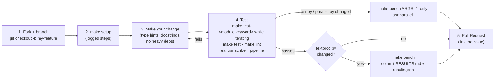

# Contributing to audio-brief

Thanks for your interest! This project is 100% open source and welcomes
contributions of all sizes — bug fixes, features, docs, or ideas.

## How to contribute

1. Fork the repo and create a branch: `git checkout -b my-feature`
2. Set up your environment (every step is logged with its duration; on failure the
   last line names the step and the fix):
   ```bash
   make setup        # = ./install.sh --dev: app + Whisper + pytest in .venv
   make setup-light  # or: app + PocketSphinx (no PyTorch, ~70 MB, ~1 min) + pytest
   ```
   Only working on text processing or docs? `make test` alone creates a light `.venv`
   with pytest (no Whisper/PyTorch download).
3. Make your changes. Keep the code style consistent with the existing code
   (type hints, docstrings, no new heavy dependencies without discussion).
4. Test your change:
   - `make test-<module>` (e.g. `make test-writers`) or `make test-<keyword>`
     (e.g. `make test-obsidian`) while iterating; `make help` lists the options
   - `make test` (whole suite) and `make lint` before opening the PR
   - `./audio-brief --help`, and a real transcribe if you touched the pipeline
   - if you changed the text analysis (`audio_brief/textproc.py`), run `make bench` (about
     15 minutes; it installs the `[bench]` tools and downloads the checksummed corpora on
     first use) and commit the regenerated `benchmarks/RESULTS.md` and
     `benchmarks/results.json`, so reviewers can see the effect on quality and speed.
     `make bench-quick` (a few minutes) is for iterating; its intervals are too wide for
     conclusions. How the numbers are measured: `benchmarks/METHODOLOGY.md`
   - if you changed speech recognition or `audio_brief/parallel.py`, re-measure just that:
     `make bench ARGS="--only asr"` / `make bench ARGS="--only parallel"` (the other results
     in `results.json` are kept)
   - documentation: every Markdown file carries at least one Mermaid diagram about its own
     content (notes exported by audio-brief excepted); `make test-docs` checks it. To check
     that diagrams render: `npx -p @mermaid-js/mermaid-cli mmdc -i FILE.md -o /tmp/out.md`
5. Open a Pull Request. Link the related issue if there is one.



## Good first issues

Check issues labeled
[`good first issue`](https://github.com/lucasrafaldini/audio-brief/labels/good%20first%20issue).
Comment on one before starting so we can assign it to you.

## Reporting bugs

Open an issue with: your OS, Python version, the command you ran, and the
full error output.

## License

By contributing, you agree that your contributions are licensed under the
MIT License.
