# 🎧 audio-brief

> 🌐 [English](README.md) · [Português (Brasil)](README.pt-BR.md) · **Español**

[](https://hacktoberfest.com)
[](https://www.python.org)
[](LICENSE)

Graba o transcribe audio con **OpenAI Whisper** y obtén automáticamente un
**resumen**, un **mapa mental**, **palabras clave** y transcripciones listas
(`.txt`, `.srt`, `.vtt`, `.json`) — todo en un solo comando. Sin claves de API,
funciona offline (tras la primera descarga del modelo).

Funciona en **Linux** y **macOS**.

## ✨ Características

- 🎙️ Graba desde el micrófono o transcribe archivos de audio existentes
- 🌍 Detección automática de idioma (o fuerza con `--language`)
- 🧠 Resumen extractivo, extracción de palabras clave y mapas mentales (Markmap + Mermaid)
- 📄 Subtítulos en SRT/VTT + `report.md` y `report.html` todo-en-uno
- 🔗 Nota lista para Obsidian (`obsidian.md`) con callout de resumen, `[[wiki-links]]` para las palabras clave principales y un árbol de temas con marcas de tiempo para grabaciones largas con muchos temas (p. ej. chats de grupo)
- 🗣️ Dos motores de voz: Whisper (preciso, muchos idiomas) o PocketSphinx (pequeño, totalmente offline, inglés; `--engine pocketsphinx`)
- 📊 Benchmarks de velocidad y calidad de los temas (`make bench`, [resultados](benchmarks/RESULTS.md))
- 🩺 El comando `doctor` revisa tu entorno (Whisper, ffmpeg, micrófono)
- ⚡ Procesamiento paralelo: varios archivos (y grabaciones largas, divididas en las pausas) se transcriben en procesos de trabajo dimensionados según tu CPU y memoria; cada archivo se resume en cuanto termina (`--jobs auto`, [detalles](#procesamiento-paralelo---jobs))
- 🖥️ CLI amigable: valores por defecto sensatos, sin preguntas en pipe/CI

## 🚀 Inicio rápido

Requiere **Python 3.10+** y **ffmpeg** (Whisper lo usa para leer los archivos de audio;
`brew install ffmpeg` en macOS, `sudo apt install ffmpeg` en Debian/Ubuntu).

```bash
git clone https://github.com/lucasrafaldini/audio-brief.git
cd audio-brief
./install.sh          # crea .venv, instala audio-brief + Whisper (PyTorch: descarga de 1-3 GB)
```

`install.sh` muestra cada paso con su duración y verifica el resultado; si algo falla,
la última línea dice el paso y cómo arreglarlo (falta `python3-venv`, Python antiguo,
falta ffmpeg...). `./install.sh --dev` añade pytest, `--bench` las herramientas de
benchmark. En Linux, el PyTorch por defecto de pip incluye CUDA (el entorno ocupa unos
5-6 GB); para instalar solo para CPU ejecuta antes `python3 -m venv .venv &&
.venv/bin/pip install torch --index-url https://download.pytorch.org/whl/cpu`.


Instalación ligera: `./install.sh --engine pocketsphinx` (o `make setup-light`) usa
PocketSphinx en lugar de Whisper: unos 70 MB instalados en cerca de un minuto en vez de 5-6 GB,
solo inglés y mucho menos preciso en conversaciones (ver
[Motores de reconocimiento de voz](#motores-de-reconocimiento-de-voz)). `--engine both`
instala los dos.

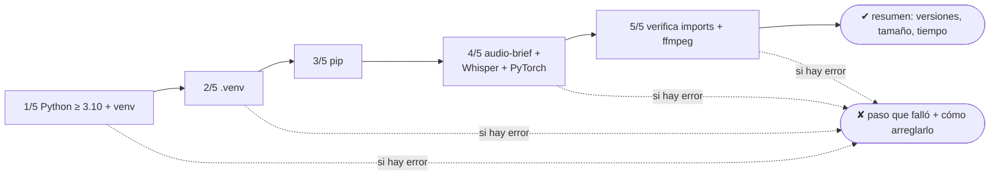


Luego:

```bash
./audio-brief transcribe reunion.mp3        # elige modelo/idioma interactivamente
./audio-brief transcribe reunion.mp3 --model base --language es
./audio-brief record 120                     # graba 2 minutos, luego transcribe
```

Tras `install.sh`, también puedes añadir el venv al PATH y usar el comando
directamente:

```bash
export PATH="$PWD/.venv/bin:$PATH"
audio-brief --help
```

### Otras formas de instalar

```bash
pip install '.[whisper]'          # en el entorno actual (motor Whisper)
pip install '.[pocketsphinx]'     # o el motor ligero PocketSphinx (los dos: '.[whisper,pocketsphinx]')
pipx install '.[whisper]'         # instalación aislada del CLI
```

Un `pip install .` simple no instala ningún motor de voz (las funciones de texto no lo necesitan).

## 📖 Uso

```
audio-brief record [segundos] [--engine E] [--model M] [--language L] [--out DIR] [--keep-raw] [--min-chars N]
audio-brief transcribe <archivo> [archivo2 ...] [--jobs N|auto] [--split-long|--no-split-long] [--engine E] [--model M] [--language L] [--out DIR] [--min-chars N]
audio-brief doctor
audio-brief --version
```

| Opción | Significado |
|--------|---------|
| `--engine E` | `whisper` (por defecto; o `$AUDIO_BRIEF_ENGINE`) o `pocketsphinx` (ligero, offline, solo inglés). Ver [Motores de reconocimiento de voz](#motores-de-reconocimiento-de-voz) |
| `--model` | `tiny` (rápido/impreciso) → `base` → `small` → `medium` → `large`/`turbo` (preciso, más lento); solo Whisper |
| `--language` | Código ISO de 2–3 letras (p. ej. `en`, `pt`, `es`). Salta la pregunta; detecta automático si no se define |
| `--out DIR` | Elige el directorio de salida |
| `--jobs N\|auto` | Procesos de trabajo para el reconocimiento de voz (solo `transcribe`). Por defecto `auto`: elegido según núcleos de CPU, memoria libre y tamaño del motor; `1` = un archivo tras otro. Ver [Procesamiento paralelo](#procesamiento-paralelo---jobs) |
| `--split-long` / `--no-split-long` | Divide archivos largos en las pausas para que varios procesos los compartan (por defecto: activado para PocketSphinx, desactivado para Whisper) |
| `--summary-n N` | Máximo de frases en el resumen (por defecto: 8) |
| `--keywords-n N` | Máximo de palabras clave extraídas (por defecto: 15) |
| `--min-chars N` | Ignora frases de menos de N caracteres ("Vale.", "jaja") en el resumen, mapa mental y árbol de temas (por defecto: 20, `0` conserva todas) |
| `--keep-raw` | Conserva el `.wav` grabado dentro de la carpeta de salida (solo `record`) |

Ejecuta `audio-brief doctor` primero si algo no funciona — revisa
Python, los motores de voz, ffmpeg, backends de grabación y (en macOS) lista los dispositivos de audio.

Ejemplos:

```bash
# un archivo, inglés, modelo medium
audio-brief transcribe clase.wav --model medium --language en

# una carpeta de grabaciones, procesos elegidos automáticamente (el plan se imprime antes)
audio-brief transcribe reuniones/*.mp3

# como máximo dos a la vez, p. ej. para que la máquina siga usable
audio-brief transcribe a.mp3 b.mp3 c.mp3 --jobs 2
```

Al ejecutarse interactivamente se te preguntará por idioma y modelo una vez;
al usarse en pipe (CI, scripts) usa auto-detección + `base`.

### Informe de procesamiento

Tras cada archivo audio-brief muestra qué hizo y cuánto tardó, por ejemplo para un
chat de grupo de 9.605 palabras (el tiempo de Whisper depende del modelo y de la
máquina):

```
--- Processing report ---
  transcription (whisper): …s for …s of audio (…x real time)
  text: 9,605 words in 736 segments (transcript had little punctuation: analysed per speech segment)
  found: 8 top-level topics, 9 mind-map branches, 11 files
  analysis + writing: 0.33s  (units 3 ms, specificity 91 ms, summary 29 ms, keywords 24 ms, topic tree 45 ms, timestamps 2 ms, mind map 37 ms, grouping 5 ms, writing files 92 ms)
```

## 📂 Salidas

Los archivos se guardan en `audio-brief-<timestamp>/` en el directorio actual (o `--out DIR`),
una carpeta `run-<n>/` por archivo transcrito, numerada en el orden en que se pasaron los archivos:

| Archivo | Contenido |
|------|---------|
| `transcript.txt` | Transcripción de texto con marcas de tiempo |
| `transcript.srt` / `.vtt` | Subtítulos |
| `transcript.json` | Datos brutos de los segmentos |
| `summary.md` | Frases clave, ordenadas por relevancia (se omiten fragmentos de menos de 20 caracteres) |
| `keywords.md` | Principales palabras clave y expresiones de dos palabras recurrentes, con cuántas veces aparecen |
| `mindmap.md` | Mapa mental: tema › subtema › frase (pega en [markmap.js.org](https://markmap.js.org)) |
| `mindmap.mmd` | Mapa mental en Mermaid ([mermaid.live](https://mermaid.live)) |
| `report.md` | Todo en un único Markdown |
| `report.html` | Mismo informe como página web autocontenida (sin visor necesario) |
| `obsidian.md` | Nota de Obsidian: callout `> [!summary]`, `[[wiki-links]]` para las 10 palabras clave principales, árbol `## Topics` de wiki-links anidados con marcas de tiempo, transcripción plegable |

## 🏗️ Arquitectura

### Estructura del proyecto

Tanto `./audio-brief` (el launcher del repositorio) como el comando
`audio-brief` instalado llegan a `audio_brief/cli.py`. La CLI se encarga de la
grabación y del reconocimiento de voz (`asr.py`; `parallel.py` reparte muchos archivos o
archivos largos entre procesos de trabajo); todo el procesamiento de texto es offline y sin dependencias.
La carpeta `benchmarks/` mide su velocidad y calidad (ver [Benchmarks](#-benchmarks)).

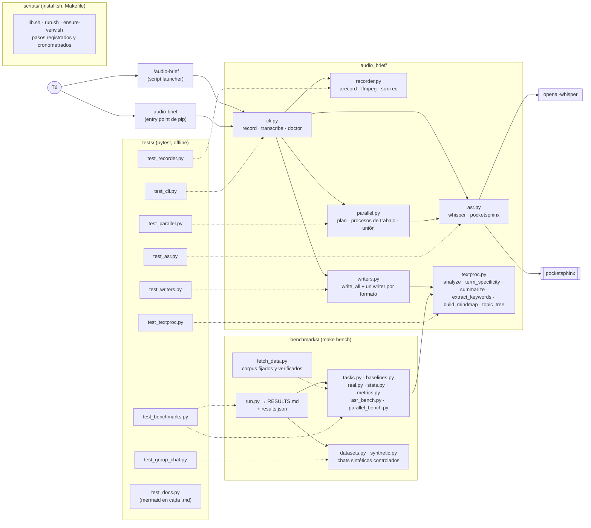

### Pipeline de procesamiento

`writers.write_all()` llama a `textproc.analyze()` una vez por archivo. Elige las
unidades de análisis (frases, o los segmentos de Whisper cuando la transcripción casi
no tiene puntuación, porque entonces las frases solo se pueden cortar en bloques de 30
palabras), puntúa la especificidad de cada palabra y calcula resumen, palabras clave,
árbol de temas (con marcas de tiempo) y mapa mental a partir de eso. `--min-chars`
(por defecto 20) deja los fragmentos cortos fuera del resumen, del mapa mental y del
árbol de temas.

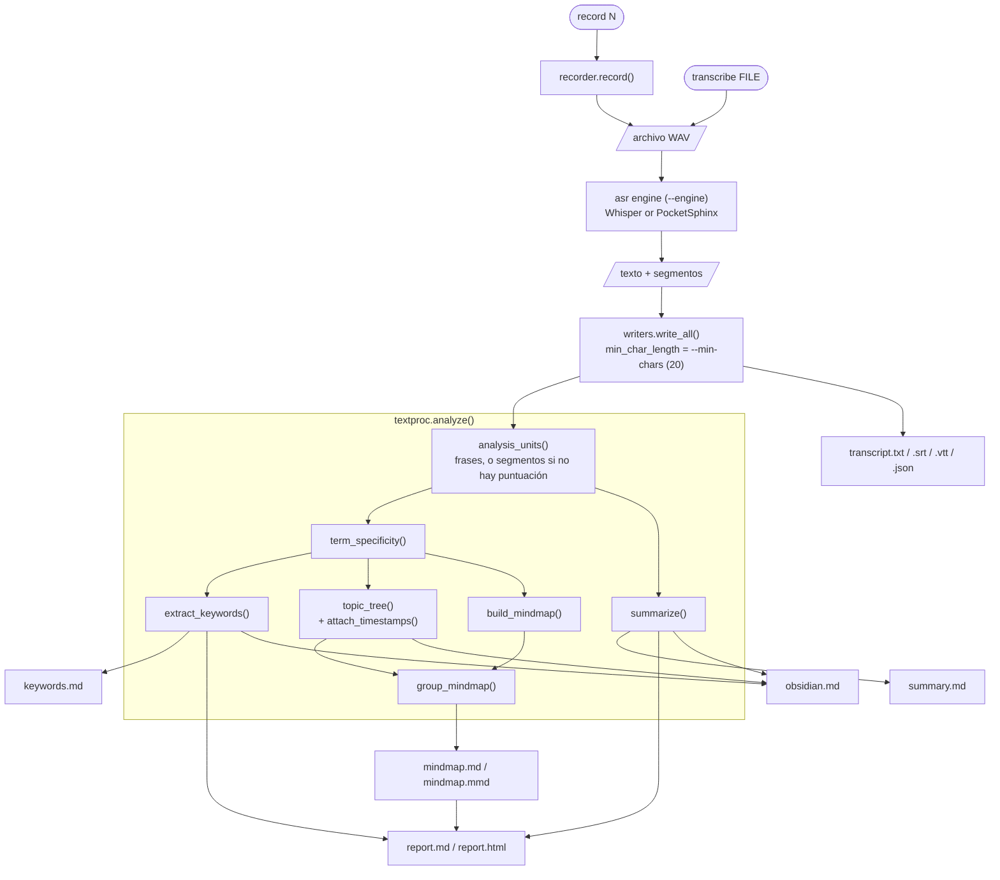

### Motores de reconocimiento de voz

`audio_brief/asr.py` pone los dos motores detrás de una única interfaz que devuelve texto,
segmentos con tiempos, idioma y duración; el resto del pipeline no sabe cuál se ejecutó.
Whisper sigue siendo el motor por defecto. PocketSphinx (CMU Sphinx, licencia BSD) es un
reconocedor estadístico independiente y más antiguo, con un modelo de inglés estadounidense
incluido: no necesita PyTorch ni descargas tras instalarlo, pero solo reconoce inglés, no
escribe puntuación (audio-brief entonces analiza por segmento de voz) y comete muchos más
errores, sobre todo en conversaciones y audio telefónico. El audio llega de ffmpeg en flujo;
la detección de voz solo decide dónde termina un enunciado (en una pausa de 0,5 s o tras
20 s): se decodifica cada trozo, así que la voz que el detector no oye no se pierde. Después
cada enunciado se decodifica entero, lo que es más preciso que decodificar en vivo.

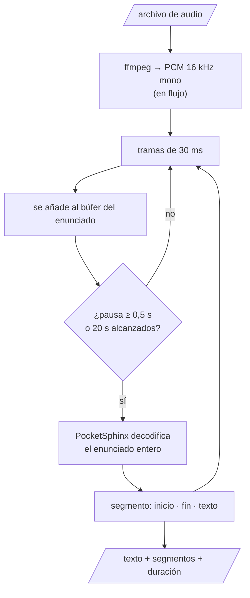

Medido en voz real (benchmarks/RESULTS.md sección 6):

| Motor | Palabras erróneas: voz leída | Palabras erróneas: llamada | Velocidad | Memoria | Tamaño instalado |
|---|---|---|---|---|---|
| PocketSphinx 5.1.1 | 27% [20-32%] | 81% | 0,80× el tiempo real | 169 MB | 39 MB |
| Whisper (tiny/base) | no medido aquí: los pesos del modelo no se pudieron descargar en el entorno del benchmark; ejecuta `make bench ARGS="--only asr"` en una máquina con internet para comparar | | | | 5.5 GB |

El conjunto de prueba es pequeño (152 palabras transcritas): las tasas de voz leída
y de llamada tienen intervalos amplios y son orientativas. Usa PocketSphinx donde Whisper no
puede ejecutarse (sin GPU ni espacio en disco, sin red en el primer uso) y el audio es inglés
claro; en otro caso, prefiere Whisper.

### Procesamiento paralelo (`--jobs`)

`audio-brief transcribe` con varios archivos, o con un archivo largo, planifica el
trabajo antes de empezar e imprime el plan con el motivo de cada decisión
(`audio_brief/parallel.py`):

- **Procesos, no threads.** El reconocimiento de voz es código de extensión Python
  limitado por la CPU que retiene el GIL de Python: dos threads de PocketSphinx fueron
  1,02× más rápidos que uno. Por eso el reconocimiento corre en procesos de trabajo,
  cada uno cargando su motor una vez. Los threads solo se usan para esperar a
  ffprobe/ffmpeg (leer duraciones, buscar pausas).
- **Cuántos procesos.** `--jobs auto` (por defecto) usa el menor entre lo que permiten los
  núcleos de CPU y la memoria libre: ~0,25 GB por proceso PocketSphinx (medido) y, para
  Whisper, los tamaños de modelo publicados por OpenAI (1 GB para `tiny`/`base` hasta
  10 GB para `large`; no medidos aquí). Cada proceso Whisper recibe además
  `núcleos ÷ procesos` threads de PyTorch, para que no compitan por los núcleos.
- **Los archivos largos se dividen en las pausas** cuando habría procesos ociosos (una
  grabación larga, o una mucho más larga que las demás): cortes cerca de cada 1-10
  minutos, movidos a la pausa más cercana (`silencedetect` de ffmpeg) para no cortar
  palabras, y luego unidos con los tiempos desplazados. Activado por defecto con
  PocketSphinx, cuya precisión al dividir se mide abajo; opcional con Whisper
  (`--split-long`), donde no se mide.
- **El trabajo más largo primero**, para que un archivo largo no empiece el último y
  haga esperar a todos.
- **Los resúmenes se solapan con el reconocimiento.** En cuanto vuelven todas las partes
  de un archivo, el proceso principal lo analiza y escribe sus archivos mientras los
  procesos siguen transcribiendo el resto. El análisis es rápido frente al reconocimiento
  (0,33 s para un chat de 9.605 palabras, ver [Informe de procesamiento](#informe-de-procesamiento)),
  así que no necesita procesos propios.
- **Progreso y fallos.** Una línea por unidad terminada con tiempo estimado; un archivo
  que falla se informa y los demás terminan igualmente (código de salida 1).

Con un archivo que no necesita dividirse, o `--jobs 1`, los archivos se procesan uno
tras otro en el proceso principal, exactamente como antes.

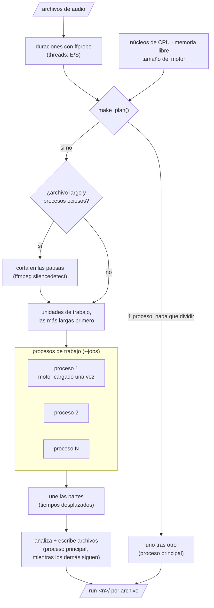

Medido con PocketSphinx en 4 núcleos ([RESULTS.md sección 7](benchmarks/RESULTS.md#7-parallel-processing)):

| Trabajo | Un proceso | `--jobs auto` | Aceleración | Precisión |
|---|---:|---:|---:|---|
| Lote: 8 grabaciones reales, 4,7 min de audio | 148 s | 38 s (4 procesos, 10 unidades: archivos largos divididos) | **3,9×** | ver la fila siguiente |
| Una grabación, 4,6 min, toda transcrita | 128 s | 57 s (5 partes en 4 procesos) | **2,2×** | tasa de error de palabras 60,5% entera, 57,4% dividida |

Dividir cambia qué palabras produce PocketSphinx (29% de las palabras difieren entre la
transcripción entera y la dividida) sin empeorarla respecto a la referencia; es una sola
grabación, así que tómalo como indicativo. Las aceleraciones son ejecuciones únicas en una
máquina virtual compartida: una ejecución anterior del mismo benchmark dio 3,8× y 2,8×. La
aceleración paralela de Whisper no se midió (sus pesos no pudieron descargarse en el entorno
del benchmark).

### Filtro de fragmentos en el resumen (`min_char_length`)

`textproc.summarize()` (también disponible como `textproc.extract_summary()`)
nunca elige frases de menos de `min_char_length` caracteres (por defecto `20`),
así que muletillas como "Vale." o "Bueno, pues." quedan fuera de los resúmenes.
Las frases cortas siguen contando en las frecuencias de palabras clave. Usa
`min_char_length=0` (CLI: `--min-chars 0`) para desactivar el filtro.

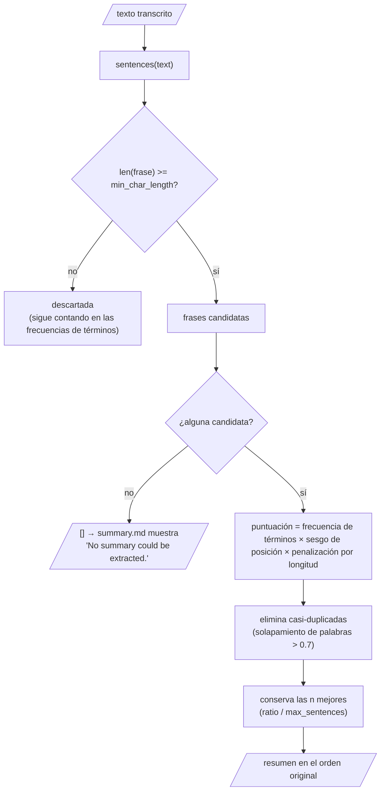

### Palabras de tema vs palabras genéricas (especificidad)

La frecuencia sola no distingue un tema del relleno: en un chat de grupo, "needs",
los nombres y los días de la semana son tan frecuentes como "hotel". Pero una
conversación se queda en un tema un rato, así que una palabra de tema predice de qué
hablan las frases *vecinas*, mientras que una palabra genérica aparece junto a
cualquier cosa (cohesión léxica, la idea de TextTiling). `textproc.term_specificity()`
puntúa cada palabra según cuánto difieren las palabras a 2 unidades o menos de ella
de toda la transcripción (divergencia KL, suavizada para no sobrevalorar palabras
raras). En el chat de 2.000 mensajes del benchmark todo sustantivo de tema puntúa por
encima de toda palabra genérica (0,19 o más vs 0,11 o menos). Las palabras clave se
ordenan sobre todo por ella (ver abajo), el árbol de temas solo usa palabras de tema y
el mapa mental pondera las palabras con ella.

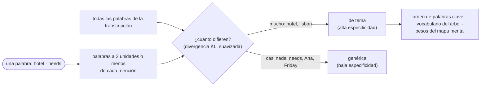

### Palabras clave y expresiones

`textproc.extract_keywords()` devuelve palabras y expresiones de dos palabras con cuántas
veces aparecen realmente. Una expresión son dos palabras de contenido *contiguas* dentro
de una frase que aparecen al menos dos veces, así que nada se une a través de un punto
o de un "the" omitido. Una expresión que solo continúa otra ya elegida ("scored twice"
en "striker scored twice") se omite, y una palabra se descarta cuando una expresión
reúne al menos el 80% de sus usos ("bank" → "bank api"). Se ordenan por menciones ×
(0,12 + 0,88 × especificidad), así que "hotel" gana a un "needs" más frecuente, mientras
el tema principal de la grabación, mencionado en todas partes y por eso *no* específico,
sigue llegando arriba (sin ese 12% de frecuencia, el tema de los artículos reales de
Wikipedia quedaba mucho más abajo: MRR 0,44 en vez de 0,75). El conteo mostrado es
siempre el real. También son los `[[wiki-links]]` de `obsidian.md`. Las palabras comunes con poco contenido (la
lista SMART de 571 palabras: "first", "used", "however" ...) se ignoran, y un término mencionado
por primera vez en el 5% inicial del texto recibe hasta el doble de peso, porque quien habla
suele presentar su tema al principio.

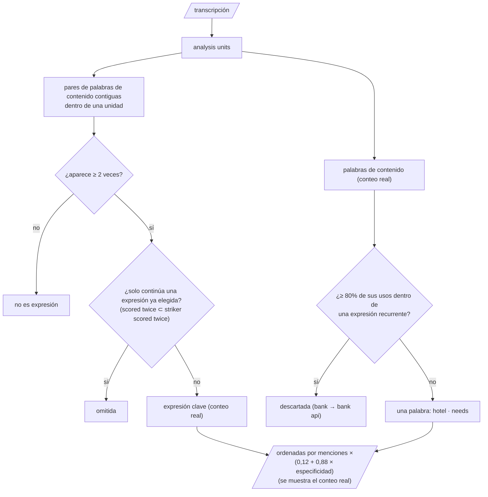

### Agrupación del mapa mental

`textproc.build_mindmap()` lee las unidades en orden. Cada una se une al grupo con las
palabras más parecidas (similitud coseno ≥ 0,3, con palabras ponderadas por
especificidad para que el relleno compartido no decida) o empieza uno nuevo; un índice
de palabras mantiene el trabajo lineal, y un grupo que no recibe frases desde hace 500 unidades
(cerca de una hora de voz) deja de aceptar nuevas, así que las grabaciones muy largas también
quedan lineales. Después `group_mindmap()` pone esos subtemas
bajo los temas de primer nivel del árbol, así que los archivos quedan tema › subtema ›
frase (un tema con un solo subtema lista sus frases directamente). En el chat de 2.000
mensajes del benchmark esto da 9 ramas para 8 temas con 100% de pureza. Extracto:

```markdown
## oven / lasagna / basil
### curry / lasagna / recipe
#### I am not sure the spices works with the lasagna.
#### Did anyone check the curry for the lasagna yet.
### basil / oven / spices
#### The spices looks good but the basil is a problem.
```

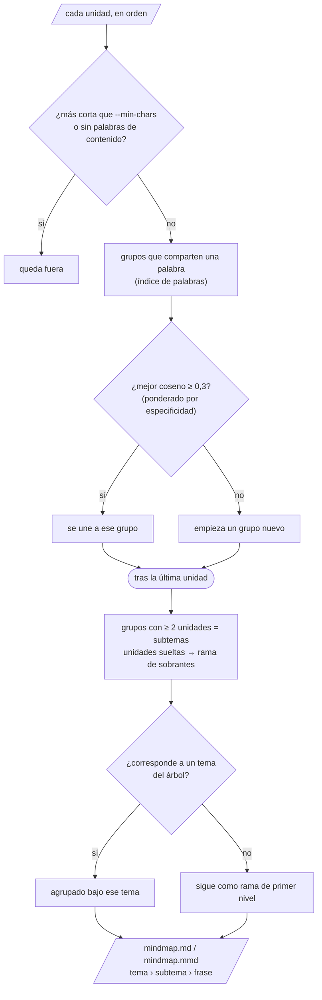

### Nota de Obsidian (`obsidian.md`)

`writers.write_obsidian_note(output_dir, text, summary, keywords)` reutiliza el
resumen y las palabras clave de `write_all`. Las palabras clave se deduplican y se
limpian de caracteres que Obsidian no admite en enlaces (`[ ] | # ^ \ / : * ? " < >`).

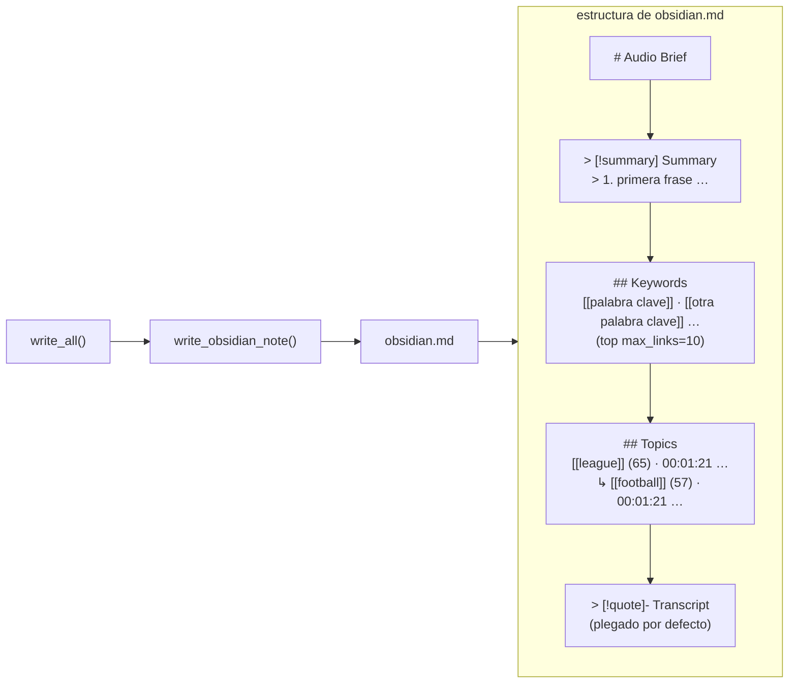

### Árbol de temas (chats de grupo y grabaciones largas)

Una grabación larga que salta de un tema a otro (un chat de grupo, una llamada semanal)
recibe una sección `## Topics` en `obsidian.md`: cada tema se convierte en una rama de
`[[wiki-links]]` anidados con el número de unidades que lo mencionan y las primeras marcas de
tiempo donde aparece. `textproc.topic_tree()` construye un grafo de las palabras clave de tema
(expresiones como `[[bank api]]` quedan enteras), uniendo dos términos según cuánto más que el
azar aparecen a una unidad o menos el uno del otro (PMI positivo, pares vistos juntos al menos
3 veces). La detección de comunidades de Louvain (Blondel et al. 2008) divide ese grafo en
temas, así que **el número de temas sale del texto**. Las comunidades que cubren menos del 5%
de las unidades de tema se descartan (fragmentos y palabras genéricas), las que aparecen en los
mismos tramos del texto (1,5× más que el azar) se vuelven subtemas de un mismo tema, y dentro
de un tema un término queda bajo otro más frecuente cuando el 70% de sus unidades lo tiene
cerca. Un ejemplo real, del benchmark: tres artículos de Wikipedia (Academy Awards, Aardvark,
Algeria) intercalados como una conversación:

```markdown
## Topics

- [[awards]] (16)
  - [[members]] (10)
    - [[categories]] (6)
  - [[film]] (12)
  - [[academy]] (9)
    - [[oscar]] (4)
- [[burrows]] (7)
  - [[aardvark]] (10)
    - [[termites]] (5)
  - [[season]] (6)
- [[political]] (6)
  - [[islamic]] (7)
  - [[bouteflika]] (5)
- [[ceremony]] (6)
- [[algeria]] (6)
```

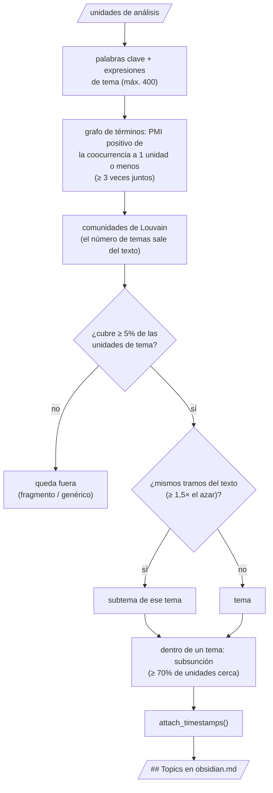

Como los temas son wiki-links simples, las grabaciones guardadas en el mismo vault
de Obsidian se conectan por los temas que comparten (backlinks y vista de grafo):

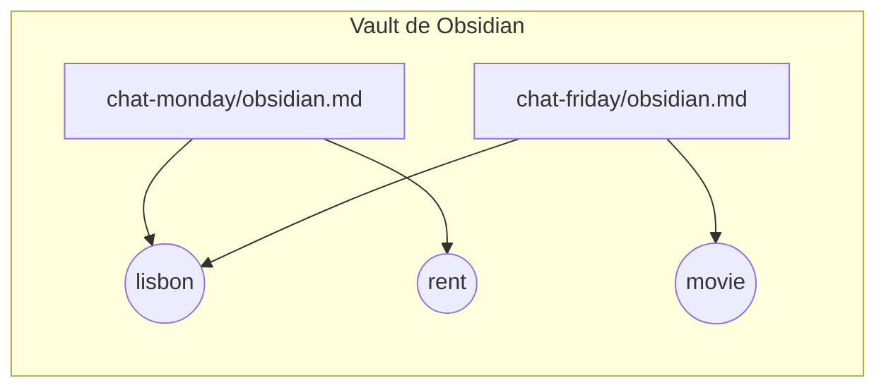

En las transcripciones reservadas para prueba esto da 0,9-1,5 temas de primer nivel
por tema real en Wikipedia (2,9 en los mensajes de Usenet) y ningún tema genérico de primer
nivel. Como muestra el ejemplo, un tema aún puede dividirse en dos (Academy Awards: awards y
ceremony), una etiqueta puede ser una palabra característica en vez del nombre del tema
("burrows" para el aardvark) y, con muchos temas, algunos se fusionan (pureza 65% con 8
temas).

## ⚙️ Backends de grabación

Se elige automáticamente: `arecord` (Linux/ALSA) → `ffmpeg` (macOS vía
avfoundation, Linux vía ALSA) → `sox rec`. Forza uno y elige el micrófono:

```bash
AUDIO_BRIEF_RECORDER=ffmpeg AUDIO_BRIEF_MIC=1 audio-brief record 60
# listar entradas de audio en macOS:
ffmpeg -f avfoundation -list_devices true -i ''
```

## 💡 Tamaño de los modelos

| Modelo | Tamaño | Velocidad (CPU) | Calidad |
|-------|------|-------------|---------|
| `tiny` | ~75 MB | más rápido | impreciso |
| `base` | ~150 MB | rápido | ok para un brief |
| `small` | ~500 MB | medio | bueno |
| `medium` | ~1,5 GB | lento | muy bueno |
| `large`/`turbo` | ~3 GB | más lento | mejor |
| PocketSphinx (`--engine pocketsphinx`) | ~40 MB, sin PyTorch | ~0,8× el tiempo real | solo inglés; ~27% de palabras erróneas en voz leída limpia, ~81% en una llamada |

## 🍎 App macOS (opcional)

```bash
.venv/bin/pip install py2app
.venv/bin/python setup.py py2app -A
# -> dist/audio-brief.app
```

## 📊 Benchmarks

La calidad y la velocidad se miden en **datos públicos y reales** con respuestas conocidas,
frente a métodos establecidos, con intervalos de confianza del 95%. Los parámetros se eligen en
una mitad de los corpus y cada número de calidad de abajo viene de la **otra mitad, reservada**.
[`benchmarks/RESULTS.md`](benchmarks/RESULTS.md) tiene todas las tablas y gráficos,
[`benchmarks/results.json`](benchmarks/results.json) cada prueba, y
[`benchmarks/METHODOLOGY.md`](benchmarks/METHODOLOGY.md) cómo se obtiene cada número.

```bash
make bench          # ~15 min: instala las herramientas [bench], descarga los datos y ejecuta todo
make bench-quick    # pasada rápida de comprobación (pocas pruebas para conclusiones)
make bench ARGS="--only asr"        # vuelve a medir solo el reconocimiento de voz (se conservan los demás resultados)
make bench ARGS="--only parallel"   # vuelve a medir solo el procesamiento paralelo
```

Datos (descargados de PyPI/npm en versiones fijas, con checksums verificados): 106 artículos de
Wikipedia, 200 mensajes de Usenet (20 Newsgroups), 233 discursos del Estado de la Unión y voz
real grabada (fragmentos de audiolibro, una llamada telefónica). Las transcripciones con varios
temas se construyen con frases reales de varias fuentes (Choi 2000), así que se conoce el tema
real de cada frase.

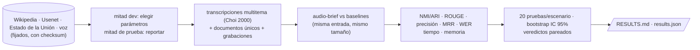

Resultados principales (mitad de prueba; valores: media [IC 95%]):

| Tarea | Datos | Métrica | audio-brief | Baseline más fuerte | Veredicto (victorias/empates/derrotas) |
|---|---|---|---|---|---|
| Descubrimiento de temas (mapa mental) | Wikipedia, 3 temas | NMI | 0,53 [0,50; 0,56] | TF-IDF + k-means (true k): 0,41 [0,37; 0,45] | **mejor** (17/0/3) |
| Descubrimiento de temas (mapa mental) | Wikipedia, 5 temas | NMI | 0,58 [0,55; 0,61] | TF-IDF + k-means (true k): 0,41 [0,37; 0,45] | **mejor** (20/0/0) |
| Descubrimiento de temas (mapa mental) | Wikipedia, 8 temas | NMI | 0,56 [0,53; 0,59] | TF-IDF + k-means (true k): 0,41 [0,38; 0,44] | **mejor** (20/0/0) |
| Descubrimiento de temas (mapa mental) | Usenet, 2 temas | NMI | 0,15 [0,14; 0,16] | TF-IDF + k-means (true k): 0,10 [0,08; 0,12] | **mejor** (15/0/5) |
| Precisión de palabras clave | Wikipedia, 5 temas | precision@15 | 84% [79%; 88%] | YAKE: 88% [84%; 92%] | **sin diferencia clara** (6/3/11) |
| Tema principal en palabras clave | 38 artículos de Wikipedia | MRR | 0,82 [0,72; 0,91] | YAKE: 0,90 [0,82; 0,97] | **sin diferencia clara** (3/24/11) |
| Resumen | 41 introducciones de Wikipedia | ROUGE-1 | 0,32 [0,30; 0,34] | LexRank: 0,34 [0,32; 0,35] | **sin diferencia clara** (16/0/25) |

Qué cambió en esta versión (misma mitad de prueba, mismo harness, código anterior → actual):

| Transcripciones | Temas de primer nivel por tema real | Temas genéricos de primer nivel | Pureza del árbol | NMI del mapa mental | Precisión de palabras clave (YAKE) |
|---|---:|---:|---:|---:|---:|
| Wikipedia, 3 temas | 3,25 → **1,48** | 39% → **0%** | 90% → **86%** | 0,50 → **0,53** | 86% → **85%** (89%) |
| Wikipedia, 5 temas | 2,17 → **1,09** | 33% → **0%** | 84% → **82%** | 0,54 → **0,58** | 83% → **84%** (88%) |
| Wikipedia, 8 temas | 1,64 → **0,90** | 18% → **0%** | 67% → **65%** | 0,54 → **0,56** | 76% → **77%** (86%) |
| Usenet, 2 temas | 7,53 → **2,90** | 10% → **0%** | 87% → **85%** | 0,13 → **0,15** | 75% → **78%** (91%) |

Tema principal en palabras clave (MRR): 0,73 → **0,82** (YAKE 0,90). Tiempo de análisis
para 1.000.000 de palabras: 137 s → **34 s**; exponente de escala 1,33 → **1,12**
(1 = lineal). Contrapartidas: la pureza del árbol bajó 0,02-0,04, y la precisión de palabras
clave sigue 4-13 puntos por detrás de YAKE (en la mitad dev parecía empatada: la mitad
reservada es la razón de reportar las dos).

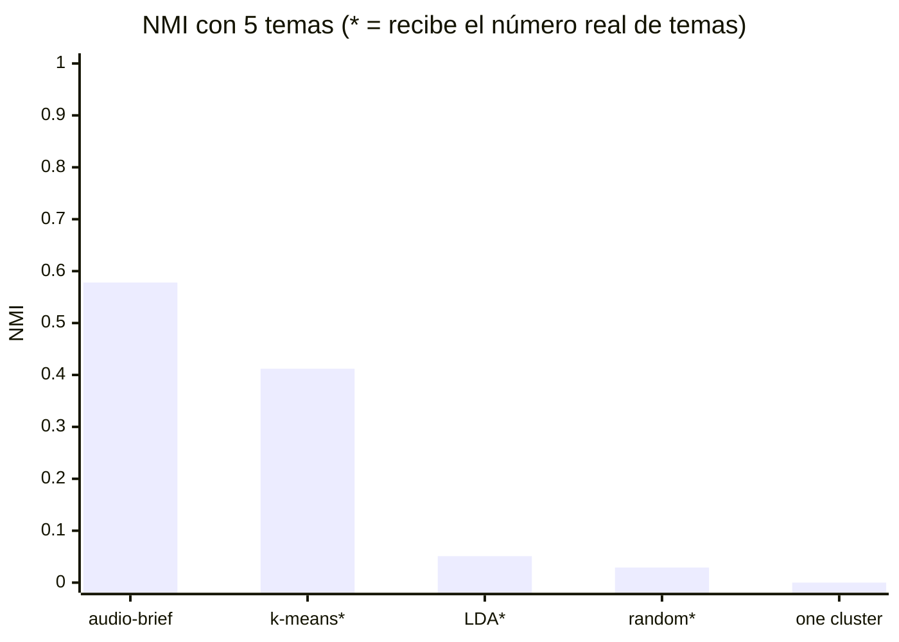

Velocidad en discursos reales: un discurso (mediana de 7.006 palabras) se analiza en una mediana
de **206 ms**; 300.000 palabras tardan 8,4 s. El reconocimiento de voz se mide aparte:
ver [Motores de reconocimiento de voz](#motores-de-reconocimiento-de-voz).

Qué dice esto:

- **Agrupar por tema es lo más fuerte**: NMI ≈ 0,58 en las mezclas de Wikipedia, mejor que TF-IDF + k-means y LDA aunque estos reciben el número real de temas; los mensajes informales de Usenet siguen siendo difíciles (NMI ≈ 0,15).
- **El árbol de temas ahora tiene cerca de un tema de primer nivel por tema real** (0,9-1,5 en Wikipedia, 2,9 en Usenet, antes hasta 3,3 y 7,5) y ningún tema genérico de primer nivel, a cambio de una pureza algo menor.
- **Las palabras clave quedan por detrás de YAKE en promedio** (precisión temática 4-13 puntos menor; MRR del tema principal 0,82 vs 0,90), aunque en esta mitad de prueba ninguna de las diferencias es estadísticamente clara.
- **Los resúmenes empatan con los métodos extractivos clásicos** (sin diferencia clara con TextRank y LexRank).
- **Voz**: PocketSphinx se equivoca en cerca del 27% de las palabras en voz leída limpia y del 81% en una llamada; Whisper no se pudo medir offline.
- **Procesamiento paralelo**: en 4 núcleos, 8 grabaciones se transcriben 3,9× más rápido que con un proceso, y una grabación de 4,6 minutos 2,2× más rápido al dividirla en las pausas, sin pérdida de precisión (ejecuciones únicas).

## 🧪 Pruebas

La suite de pruebas funciona offline (Whisper está simulado), así que no necesita la
instalación completa: en un clon nuevo `make test` crea por sí solo un `.venv` ligero
con pytest (sin tocar el Python del sistema) y reutiliza el entorno de `make setup`
si existe. Cada ejecución registra el intérprete, el comando exacto, las 5 pruebas
más lentas, las pruebas omitidas con su motivo y el tiempo total. `PYTHON=...` usa
otro intérprete (verificado, nunca modificado); `make help` lista todos los objetivos.

| Comando | Ejecuta |
|---------|------|
| `make test` | La suite completa |
| `make test-writers` | Un módulo, `tests/test_writers.py` (también `cli`, `group_chat` / `group-chat`, `recorder`, `textproc`, `asr`, `parallel`, `docs`, `benchmarks`) |
| `make test-obsidian` | Toda prueba cuyo nombre contiene `obsidian`, en todos los módulos |
| `make test K="topic_tree and not empty"` | Cualquier expresión `-k` de pytest |
| `make test-list` | Lista todos los ids de prueba |
| `make test-textproc ARGS="-x --lf"` | Flags extra de pytest para cualquier objetivo |

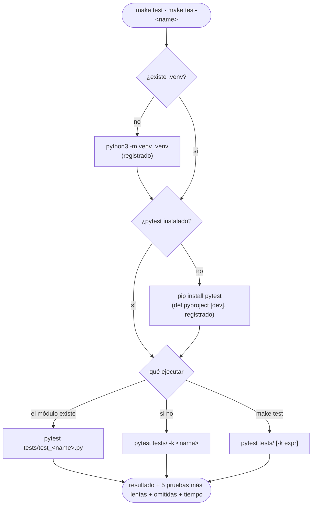

## 🤝 Contribuir

¡Los PRs son bienvenidos — especialmente en Hacktoberfest! Ideas:

- Diarización de hablantes
- Resúmenes con LLM (flag opcional)
- Más formatos de salida (p. ej. Anki)
- Mejor soporte para Windows / interfaz gráfica

```bash
git clone https://github.com/lucasrafaldini/audio-brief.git
cd audio-brief && ./install.sh
```

Abre un issue antes de cambios grandes para alinear el alcance.

Ver también: [CONTRIBUTING.md](CONTRIBUTING.md) · [CODE_OF_CONDUCT.md](CODE_OF_CONDUCT.md) · [SECURITY.md](SECURITY.md) · [LICENSE](LICENSE)

## 📜 Licencia

MIT
