# 🎧 audio-brief

> 🌐 **English** · [Português (Brasil)](README.pt-BR.md) · [Español](README.es.md)

[](https://hacktoberfest.com)
[](https://www.python.org)
[](LICENSE)

Record or transcribe audio with **OpenAI Whisper** and automatically get a
**summary**, a **mind map**, **keywords**, and ready-to-use transcripts
(`.txt`, `.srt`, `.vtt`, `.json`) — all in one command. No API keys, runs
offline (after the first model download).

Works on **Linux** and **macOS**.

## ✨ Features

- 🎙️ Record from your microphone or transcribe existing audio files
- 🌍 Auto language detection (or force it with `--language`)
- 🧠 Extractive summary, keyword extraction, and mind maps (Markmap + Mermaid)
- 📄 Subtitles in SRT/VTT + bundled `report.md` and `report.html`
- 🔗 Obsidian-ready note (`obsidian.md`) with a summary callout, `[[wiki-links]]` for top keywords and a topic tree with timestamps for long, multi-topic recordings (e.g. group chats)
- 🗣️ Two speech engines: Whisper (accurate, many languages) or PocketSphinx (small, fully offline, English; `--engine pocketsphinx`)
- 📊 Benchmarks for speed and topic quality (`make bench`, [results](benchmarks/RESULTS.md))
- 🩺 `doctor` command checks your environment (Whisper, ffmpeg, mic)
- ⚡ Parallel processing: several files (and long recordings, split at pauses) are transcribed by worker processes sized to your CPU and memory; each file is summarised as soon as it is done (`--jobs auto`, [details](#parallel-processing---jobs))
- 🖥️ Friendly CLI: sensible defaults, zero prompts when piped/CI

## 🚀 Quick start

Requires **Python 3.10+** and **ffmpeg** (Whisper uses it to read audio files;
`brew install ffmpeg` on macOS, `sudo apt install ffmpeg` on Debian/Ubuntu).

```bash
git clone https://github.com/lucasrafaldini/audio-brief.git
cd audio-brief
./install.sh          # creates .venv, installs audio-brief + Whisper (PyTorch: 1-3 GB download)
```

`install.sh` prints every step with its duration and checks the result; if something
fails, the last line names the step and the fix (missing `python3-venv`, old Python,
missing ffmpeg...). `./install.sh --dev` adds pytest, `--bench` the benchmark tools.
On Linux, pip's default PyTorch includes CUDA (the environment is about 5-6 GB); for a
CPU-only install run `python3 -m venv .venv && .venv/bin/pip install torch --index-url
https://download.pytorch.org/whl/cpu` first.


Light install: `./install.sh --engine pocketsphinx` (or `make setup-light`) uses
PocketSphinx instead of Whisper: about 70 MB installed in about a minute instead of 5-6 GB,
English only and much less accurate on conversations (see
[Speech recognition engines](#speech-recognition-engines)). `--engine both` installs both.

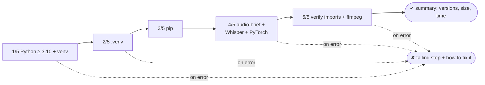


Then:

```bash
./audio-brief transcribe meeting.mp3        # pick model/language interactively
./audio-brief transcribe meeting.mp3 --model base --language en
./audio-brief record 120                     # record 2 minutes, then transcribe
```

After `install.sh`, you can also add the venv to your PATH and use the command
directly:

```bash
export PATH="$PWD/.venv/bin:$PATH"
audio-brief --help
```

### Alternative installs

```bash
pip install '.[whisper]'          # into your current environment (Whisper engine)
pip install '.[pocketsphinx]'     # or the light PocketSphinx engine (both: '.[whisper,pocketsphinx]')
pipx install '.[whisper]'         # isolated CLI install
```

Plain `pip install .` installs no speech engine (the text features need none).

## 📖 Usage

```
audio-brief record [seconds] [--engine E] [--model M] [--language L] [--out DIR] [--keep-raw] [--min-chars N]
audio-brief transcribe <file> [file2 ...] [--jobs N|auto] [--split-long|--no-split-long] [--engine E] [--model M] [--language L] [--out DIR] [--min-chars N]
audio-brief doctor
audio-brief --version
```

| Option | Meaning |
|--------|---------|
| `--engine E` | `whisper` (default; or `$AUDIO_BRIEF_ENGINE`) or `pocketsphinx` (light, offline, English only). See [Speech recognition engines](#speech-recognition-engines) |
| `--model` | `tiny` (fast/fuzzy) → `base` → `small` → `medium` → `large`/`turbo` (accurate, slower); Whisper only |
| `--language` | 2–3 letter ISO code (e.g. `en`, `pt`, `es`). Skips the prompt; auto-detect if unset |
| `--out DIR` | Choose the output directory |
| `--jobs N\|auto` | Worker processes for speech recognition (`transcribe` only). Default `auto`: chosen from CPU cores, free memory and the engine's size; `1` = one file after the other. See [Parallel processing](#parallel-processing---jobs) |
| `--split-long` / `--no-split-long` | Split long files at pauses so several workers share them (default: on for PocketSphinx, off for Whisper) |
| `--summary-n N` | Max sentences in the summary (default: 8) |
| `--keywords-n N` | Max keywords extracted (default: 15) |
| `--min-chars N` | Ignore sentences shorter than N characters ("Okay.", "lol") in the summary, mind map and topic tree (default: 20, `0` keeps all) |
| `--keep-raw` | Keep the recorded `.wav` inside the output folder (`record` only) |

Run `audio-brief doctor` first if something doesn't work — it checks
Python, the speech engines, ffmpeg, recording backends and (on macOS) lists audio devices.

Examples:

```bash
# one file, English, medium model
audio-brief transcribe lecture.wav --model medium --language en

# a folder of recordings, workers chosen automatically (the plan is printed first)
audio-brief transcribe meetings/*.mp3

# at most two at a time, e.g. to keep the machine usable
audio-brief transcribe a.mp3 b.mp3 c.mp3 --jobs 2
```

When run interactively you'll be asked for language and model once; when
piped (CI, scripts) it silently uses auto-detect + `base`.

### Processing report

After each file audio-brief prints what it did and how long it took, e.g. for a
9,605-word group chat (Whisper's own time depends on the model and the machine):

```
--- Processing report ---
  transcription (whisper): …s for …s of audio (…x real time)
  text: 9,605 words in 736 segments (transcript had little punctuation: analysed per speech segment)
  found: 8 top-level topics, 9 mind-map branches, 11 files
  analysis + writing: 0.33s  (units 3 ms, specificity 91 ms, summary 29 ms, keywords 24 ms, topic tree 45 ms, timestamps 2 ms, mind map 37 ms, grouping 5 ms, writing files 92 ms)
```

## 📂 Output

Files land in `audio-brief-<timestamp>/` in the current directory (or `--out DIR`),
one `run-<n>/` folder per transcribed file, numbered in the order the files were given:

| File | Content |
|------|---------|
| `transcript.txt` | Timestamped plain-text transcript |
| `transcript.srt` / `.vtt` | Subtitles |
| `transcript.json` | Raw segment data |
| `summary.md` | Key sentences, ranked (fragments under 20 characters are skipped) |
| `keywords.md` | Top keywords and recurring two-word phrases, with how often they occur |
| `mindmap.md` | Mind map: topic › sub-topic › sentence (paste into [markmap.js.org](https://markmap.js.org)) |
| `mindmap.mmd` | Mind map in Mermaid ([mermaid.live](https://mermaid.live)) |
| `report.md` | Everything bundled in one Markdown file |
| `report.html` | Same report as a self-contained web page (no viewer needed) |
| `obsidian.md` | Obsidian note: `> [!summary]` callout, `[[wiki-links]]` for the top 10 keywords, `## Topics` tree of nested wiki-links with timestamps, collapsible transcript |

## 🏗️ Architecture

### Project structure

Both `./audio-brief` (the repo launcher) and the installed `audio-brief`
command end up in `audio_brief/cli.py`. The CLI handles recording and speech
recognition (`asr.py`; `parallel.py` spreads many or long files over worker
processes); all text processing is offline and dependency-free. `benchmarks/` measures its
speed and quality (see [Benchmarks](#-benchmarks)).

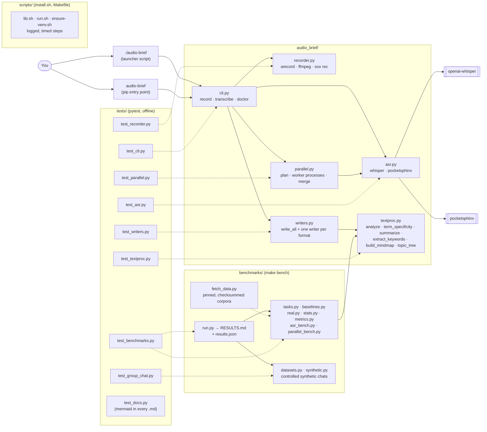

### Processing pipeline

`writers.write_all()` calls `textproc.analyze()` once per file. It picks the
analysis units (sentences, or Whisper's segments when the transcript has almost
no punctuation, because then sentences can only be cut as 30-word chunks), scores
every word's specificity, and computes summary, keywords, topic tree (with
timestamps) and mind map from that. `--min-chars` (default 20) keeps short fragments
out of the summary, mind map and topic tree.

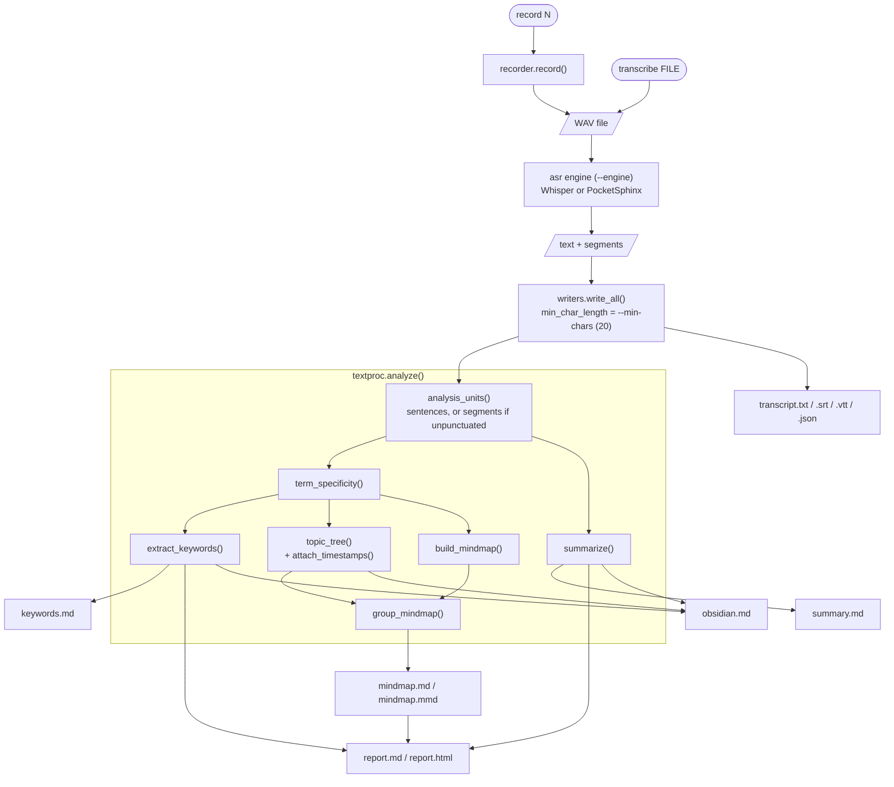

### Speech recognition engines

`audio_brief/asr.py` puts both engines behind one interface that returns text, timed
segments, language and duration; the rest of the pipeline does not know which one ran.
Whisper stays the default. PocketSphinx (CMU Sphinx, BSD licence) is an independent, older
statistical recogniser with a bundled US-English model: it needs no PyTorch and no download
after install, but it is English-only, writes no punctuation (audio-brief then analyses per
speech segment) and makes far more errors, especially on conversational or telephone audio.
Audio is streamed from ffmpeg; voice-activity detection only decides where an utterance ends
(at a 0.5 s pause, or after 20 s): every frame is decoded, so speech the detector misses is
not lost. Each utterance is then decoded as a whole, which is more accurate than live
decoding.

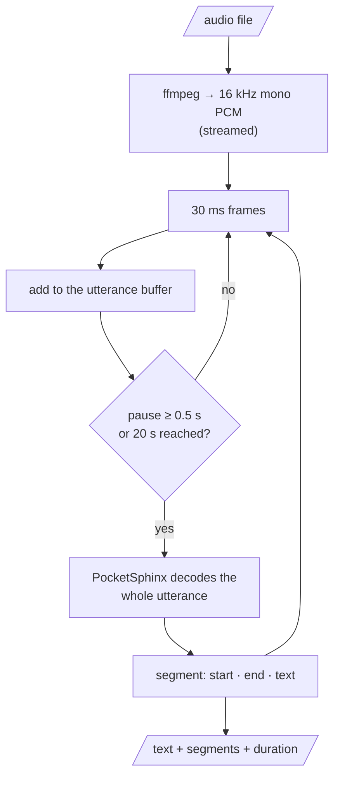

Measured on real speech (benchmarks/RESULTS.md section 6):

| Engine | Words wrong: read speech | Words wrong: phone call | Speed | Memory | Installed size |
|---|---|---|---|---|---|
| PocketSphinx 5.1.1 | 27% [20-32%] | 81% | 0.80× real time | 169 MB | 39 MB |
| Whisper (tiny/base) | not measured here: its model weights could not be downloaded in the benchmark environment; run `make bench ARGS="--only asr"` on a machine with internet access to compare | | | | 5.5 GB |

The test set is small (152 transcribed words): read-speech and phone-call rates
have wide intervals and are indicative. Use PocketSphinx where Whisper cannot run (no GPU or
disk space, no network on first use) and the audio is clear English; prefer Whisper otherwise.

### Parallel processing (`--jobs`)

`audio-brief transcribe` with several files, or with one long file, plans the work
before starting and prints the plan with a reason for each decision
(`audio_brief/parallel.py`):

- **Processes, not threads.** Speech recognition is CPU-bound Python-extension code
  that holds Python's GIL: two PocketSphinx threads ran 1.02× as fast as one. So
  recognition runs in worker processes, each loading its engine once. Threads are
  used only for waiting on ffprobe/ffmpeg (reading durations, finding pauses).
- **How many workers.** `--jobs auto` (the default) takes the smaller of what the
  CPU cores and the free memory allow: ~0.25 GB per PocketSphinx worker (measured),
  and for Whisper the model sizes OpenAI publishes (1 GB for `tiny`/`base` up to
  10 GB for `large`; not measured here). Whisper workers also get
  `cores ÷ workers` PyTorch threads each, so they don't fight over cores.
- **Long files are split at pauses** when workers would otherwise sit idle (one
  long recording, or one much longer than the rest): cut near every 1-10 minutes,
  moved to the nearest pause (ffmpeg `silencedetect`) so words are not cut, then
  joined back with shifted timestamps. On by default for PocketSphinx, whose
  accuracy with splitting is measured below; opt-in for Whisper (`--split-long`),
  where it is not measured.
- **Longest work first**, so a long file does not start last and keep everyone waiting.
- **Summaries overlap with recognition.** As soon as every part of a file is
  back, the main process analyses it and writes its files while the workers keep
  transcribing the rest. Analysis is fast next to recognition (0.33 s for a
  9,605-word chat, see [Processing report](#processing-report)), so it needs no
  workers of its own.
- **Progress and failures.** A line per finished unit with an ETA; a file that fails
  is reported and the others still finish (exit code 1).

With one file that does not need splitting, or `--jobs 1`, files are processed one
after the other in the main process, exactly as before.

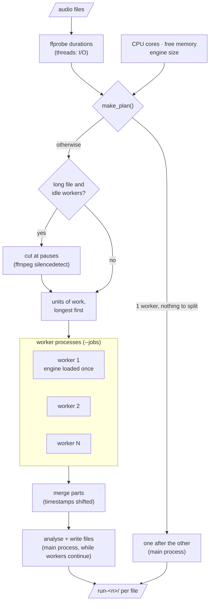

Measured with PocketSphinx on 4 cores ([RESULTS.md section 7](benchmarks/RESULTS.md#7-parallel-processing)):

| Work | One worker | `--jobs auto` | Speed-up | Accuracy |
|---|---:|---:|---:|---|
| Batch: 8 real recordings, 4.7 min of audio | 148 s | 38 s (4 workers, 10 units: long files split) | **3.9×** | see next row |
| One recording, 4.6 min, fully transcribed | 128 s | 57 s (5 parts on 4 workers) | **2.2×** | word error rate 60.5% whole, 57.4% split |

Splitting changes which words PocketSphinx outputs (29% of words differ between the
whole and the split transcript) without making it worse against the reference; this is one
recording, so treat it as indicative. Speed-ups are single runs on a shared virtual machine:
an earlier run of the same benchmark gave 3.8× and 2.8×. Whisper's parallel speed-up is not
measured (its weights could not be downloaded in the benchmark environment).

### Summary fragment filter (`min_char_length`)

`textproc.summarize()` (also available as `textproc.extract_summary()`) never
picks sentences shorter than `min_char_length` characters (default `20`), so
filler like "Okay." or "Right, so." stays out of summaries. Short sentences
still count towards keyword frequencies. Pass `min_char_length=0` (CLI:
`--min-chars 0`) to turn the filter off.

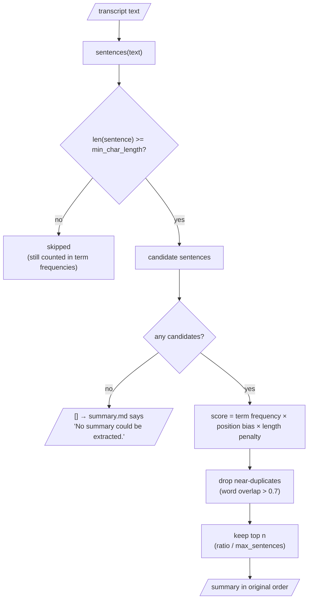

### Topic words vs generic words (specificity)

Frequency alone cannot tell a topic from filler: in a group chat, "needs", names
and weekdays are as frequent as "hotel". But a conversation stays on a subject for
a while, so a topic word predicts what the *neighbouring* sentences are about, while
a generic word shows up next to anything (lexical cohesion, the idea behind
TextTiling). `textproc.term_specificity()` scores each word by how different the
words within 2 units of it are from the whole transcript (KL divergence, smoothed so
rare words are not over-rated). In the 2,000-message benchmark chat every topic noun
scores above every generic word (0.19 or more vs 0.11 or less). Keywords are ranked
mostly by it (see below), the topic tree only uses topical words, and the mind map
weights words by it.

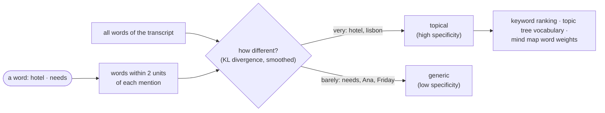

### Keywords and phrases

`textproc.extract_keywords()` returns single words and two-word phrases with how
often they really occur. A phrase is two *adjacent* content words inside one sentence
that occur at least twice, so nothing is stitched across a sentence break or a
skipped "the". A phrase that only continues one already chosen ("scored twice" in
"striker scored twice") is skipped, and a word is dropped when one phrase accounts for
at least 80% of its uses ("bank" → "bank api"). They are ranked by mentions ×
(0.12 + 0.88 × specificity), so "hotel" beats a more frequent "needs", while a
recording's main subject, mentioned everywhere and therefore *not* specific, still
reaches the top (without that 12% frequency share, the article subject ranked far
lower on real Wikipedia articles: MRR 0.44 instead of 0.75). The count shown is
always the real one. These are also the `[[wiki-links]]` in `obsidian.md`. Common content-light words (the
571-word SMART stop list: "first", "used", "however" ...) are ignored, and a term first
mentioned in the opening 5% of the text gets up to double weight, because speakers usually
introduce their subject early.

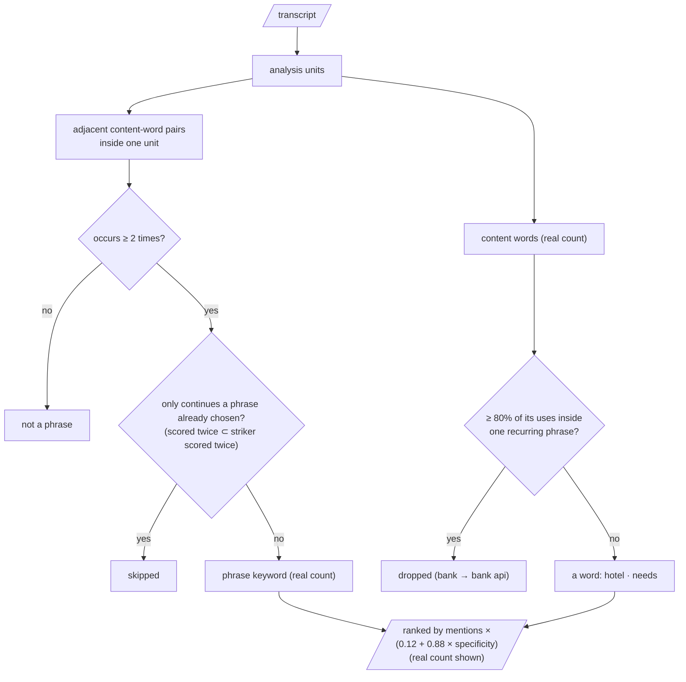

### Mind map clustering

`textproc.build_mindmap()` reads the units in order. Each one joins the cluster
whose words are most similar (cosine similarity ≥ 0.3, with words weighted by
specificity so shared filler does not decide) or starts a new one; a word index keeps
the work linear, and a cluster that has received no sentence for 500 units (about an hour
of speech) stops accepting new ones, so very long recordings stay linear too. `group_mindmap()` then puts those sub-topics under the topic tree's
top-level topics, so the files read topic › sub-topic › sentence (a topic with a
single sub-topic lists its sentences directly). On the 2,000-message benchmark chat
this gives 9 branches for 8 subjects at 100% purity. Excerpt:

```markdown
## oven / lasagna / basil
### curry / lasagna / recipe
#### I am not sure the spices works with the lasagna.
#### Did anyone check the curry for the lasagna yet.
### basil / oven / spices
#### The spices looks good but the basil is a problem.
```

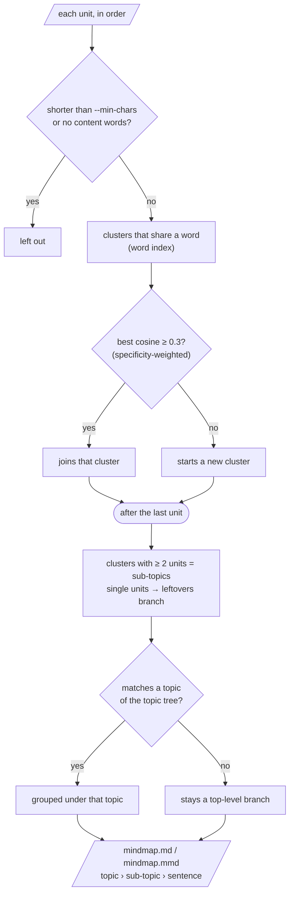

### Obsidian note (`obsidian.md`)

`writers.write_obsidian_note(output_dir, text, summary, keywords)` reuses the
summary and keywords from `write_all`. Keywords are de-duplicated and stripped of
characters Obsidian can't use in links (`[ ] | # ^ \ / : * ? " < >`).

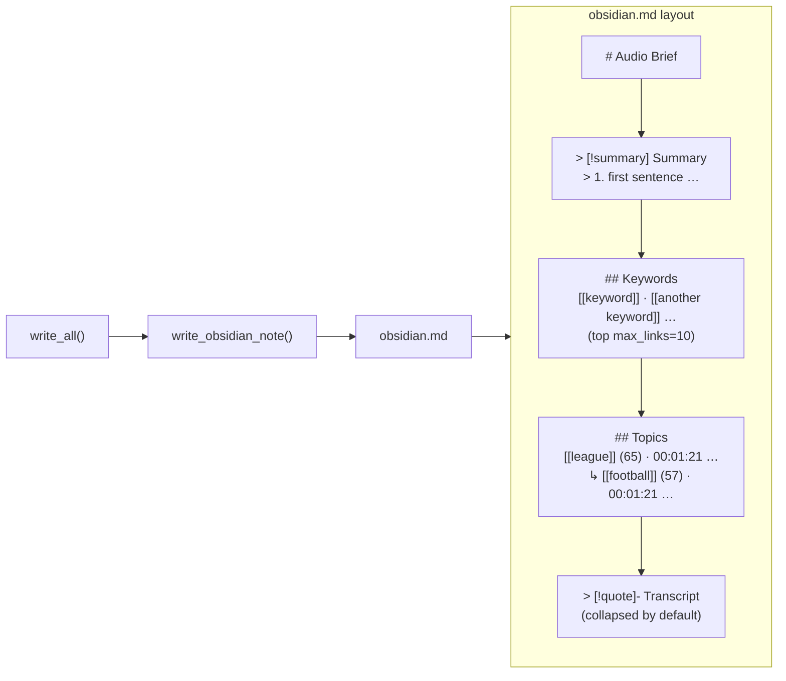

### Topic tree (group chats and long recordings)

A long recording that jumps between subjects (a group chat, a weekly call) gets a
`## Topics` section in `obsidian.md`: every subject becomes a branch of nested
`[[wiki-links]]` with the number of units mentioning it and the first timestamps where it
comes up. `textproc.topic_tree()` builds a graph of the topical keywords (phrases such as
`[[bank api]]` stay whole), linking two terms by how much more often than chance they
appear within one unit of each other (positive PMI, pairs seen together at least 3 times).
Louvain community detection (Blondel et al. 2008) splits that graph into topics, so **the
number of topics comes from the text**. Communities covering less than 5% of the topical
units are dropped (fragments and generic words), communities that occur in the same
stretches of text (1.5× more than chance) become sub-topics of one subject, and inside a
topic a term goes under a more frequent one when 70% of its units have it nearby. A real
example, from the benchmark: three Wikipedia articles (Academy Awards, Aardvark, Algeria)
interleaved like a conversation:

```markdown
## Topics

- [[awards]] (16)
  - [[members]] (10)
    - [[categories]] (6)
  - [[film]] (12)
  - [[academy]] (9)
    - [[oscar]] (4)
- [[burrows]] (7)
  - [[aardvark]] (10)
    - [[termites]] (5)
  - [[season]] (6)
- [[political]] (6)
  - [[islamic]] (7)
  - [[bouteflika]] (5)
- [[ceremony]] (6)
- [[algeria]] (6)
```

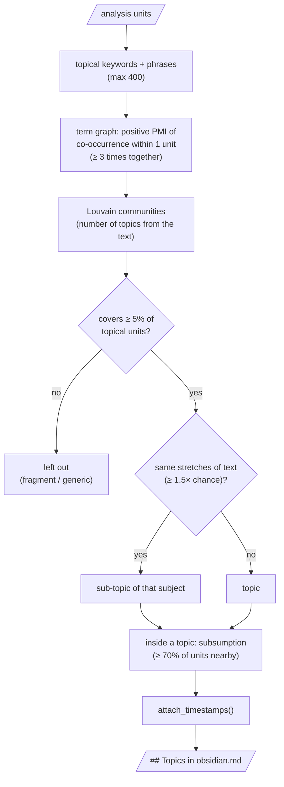

Because topics are plain wiki-links, recordings saved into the same Obsidian vault
connect through the subjects they share (backlinks and graph view):

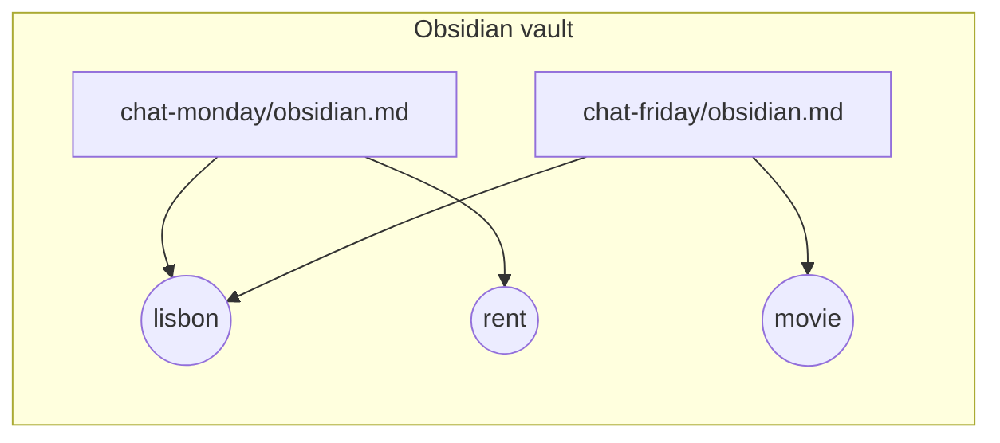

On the held-out benchmark transcripts this gives 0.9-1.5 top-level topics per
real subject on Wikipedia (2.9 on Usenet posts) and no generic top-level topics. As the
example shows, one subject can still split in two (Academy Awards: awards and ceremony), a
label can be a characteristic word rather than the subject's name ("burrows" for the
aardvark), and with many subjects some merge (purity 65% with 8 topics).

## ⚙️ Recording backends

Picked automatically: `arecord` (Linux/ALSA) → `ffmpeg` (macOS via
avfoundation, Linux via ALSA) → `sox rec`. Force one and choose a mic:

```bash
AUDIO_BRIEF_RECORDER=ffmpeg AUDIO_BRIEF_MIC=1 audio-brief record 60
# list macOS audio inputs:
ffmpeg -f avfoundation -list_devices true -i ''
```

## 💡 Model sizing

| Model | Size | Speed (CPU) | Quality |
|-------|------|-------------|---------|
| `tiny` | ~75 MB | fastest | fuzzy |
| `base` | ~150 MB | fast | ok for a brief |
| `small` | ~500 MB | medium | good |
| `medium` | ~1.5 GB | slow | great |
| `large`/`turbo` | ~3 GB | slowest | best |
| PocketSphinx (`--engine pocketsphinx`) | ~40 MB, no PyTorch | ~0.8× real time | English only; ~27% word errors on clean read speech, ~81% on a phone call |

## 🍎 macOS app bundle (optional)

```bash
.venv/bin/pip install py2app
.venv/bin/python setup.py py2app -A
# -> dist/audio-brief.app
```

## 📊 Benchmarks

Quality and speed are measured on **public, real-world data** with known answers, against
established methods, with 95% confidence intervals. Parameters are chosen on one half of the
corpora and every quality number below comes from the **other, held-out half**.
[`benchmarks/RESULTS.md`](benchmarks/RESULTS.md) has every table and chart,
[`benchmarks/results.json`](benchmarks/results.json) every trial, and
[`benchmarks/METHODOLOGY.md`](benchmarks/METHODOLOGY.md) how each number is produced.

```bash
make bench          # ~15 min: installs the [bench] tools, downloads the data, runs everything
make bench-quick    # small smoke run (too few trials for conclusions)
make bench ARGS="--only asr"        # re-measure speech recognition only (other results are kept)
make bench ARGS="--only parallel"   # re-measure parallel processing only
```

Data (downloaded from PyPI/npm at pinned versions, checksums verified): 106 Wikipedia articles,
200 Usenet posts (20 Newsgroups), 233 State of the Union addresses, and real recorded speech
(audiobook utterances, a telephone conversation). Multi-topic transcripts are built from real
sentences of several sources (Choi 2000), so the true topic of every sentence is known.

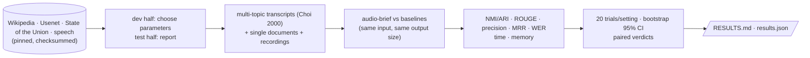

Key results (test half; values: mean [95% CI]):

| Task | Data | Metric | audio-brief | Strongest baseline | Verdict (wins/ties/losses) |
|---|---|---|---|---|---|
| Topic discovery (mind map) | Wikipedia, 3 topics | NMI | 0.53 [0.50, 0.56] | TF-IDF + k-means (true k): 0.41 [0.37, 0.45] | **better** (17/0/3) |
| Topic discovery (mind map) | Wikipedia, 5 topics | NMI | 0.58 [0.55, 0.61] | TF-IDF + k-means (true k): 0.41 [0.37, 0.45] | **better** (20/0/0) |
| Topic discovery (mind map) | Wikipedia, 8 topics | NMI | 0.56 [0.53, 0.59] | TF-IDF + k-means (true k): 0.41 [0.38, 0.44] | **better** (20/0/0) |
| Topic discovery (mind map) | Usenet, 2 topics | NMI | 0.15 [0.14, 0.16] | TF-IDF + k-means (true k): 0.10 [0.08, 0.12] | **better** (15/0/5) |
| Keyword precision | Wikipedia, 5 topics | precision@15 | 84% [79%, 88%] | YAKE: 88% [84%, 92%] | **no clear difference** (6/3/11) |
| Main subject in keywords | 38 Wikipedia articles | MRR | 0.82 [0.72, 0.91] | YAKE: 0.90 [0.82, 0.97] | **no clear difference** (3/24/11) |
| Summary | 41 Wikipedia leads | ROUGE-1 | 0.32 [0.30, 0.34] | LexRank: 0.34 [0.32, 0.35] | **no clear difference** (16/0/25) |

What changed in this version (same test half, same harness, previous code → current code):

| Transcripts | Top-level topics per real topic | Generic top-level topics | Topic tree purity | Mind-map NMI | Keyword precision (YAKE) |
|---|---:|---:|---:|---:|---:|
| Wikipedia, 3 topics | 3.25 → **1.48** | 39% → **0%** | 90% → **86%** | 0.50 → **0.53** | 86% → **85%** (89%) |
| Wikipedia, 5 topics | 2.17 → **1.09** | 33% → **0%** | 84% → **82%** | 0.54 → **0.58** | 83% → **84%** (88%) |
| Wikipedia, 8 topics | 1.64 → **0.90** | 18% → **0%** | 67% → **65%** | 0.54 → **0.56** | 76% → **77%** (86%) |
| Usenet, 2 topics | 7.53 → **2.90** | 10% → **0%** | 87% → **85%** | 0.13 → **0.15** | 75% → **78%** (91%) |

Main subject in keywords (MRR): 0.73 → **0.82** (YAKE 0.90). Analysis time for
1,000,000 words: 137 s → **34 s**; scaling exponent 1.33 → **1.12** (1 = linear).
Trade-offs: topic-tree purity is 0.02-0.04 lower, and keyword precision is still 4-13 points
behind YAKE (on the dev half it had looked level: the held-out half is why both are reported).

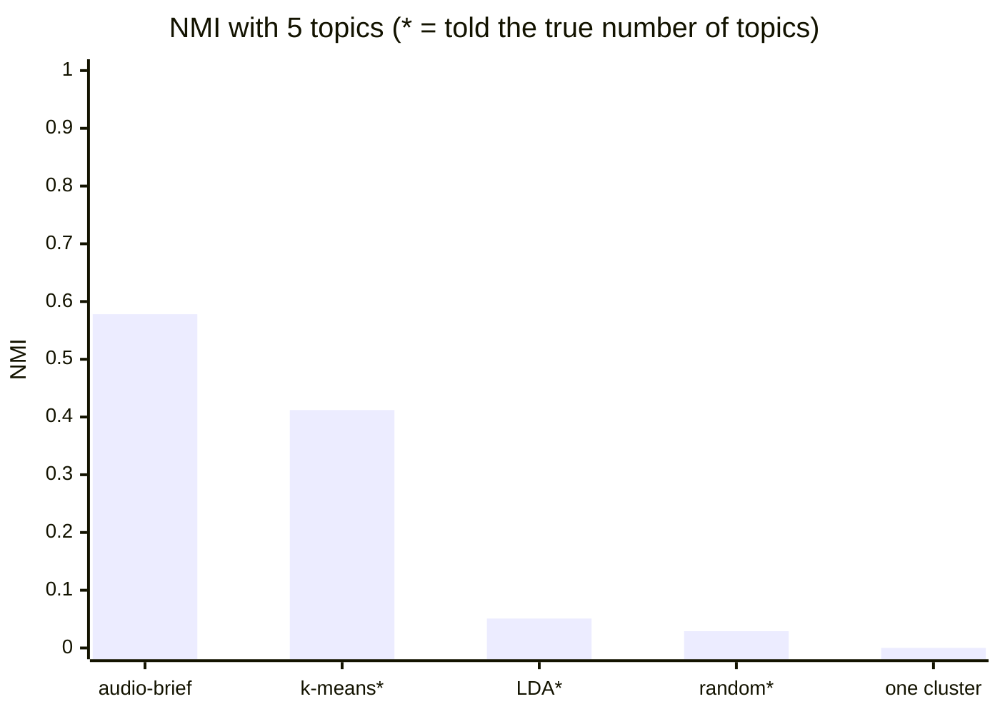

Speed on real speeches: a single address (median 7,006 words) is analysed in a median of
**206 ms**; 300,000 words take 8.4 s. Speech recognition is measured separately: see
[Speech recognition engines](#speech-recognition-engines).

What this says:

- **Topic grouping is the strongest part**: NMI ≈ 0.58 on Wikipedia mixtures, better than TF-IDF + k-means and LDA even though they are told the true number of topics; informal Usenet posts stay hard (NMI ≈ 0.15).
- **The topic tree now has about one top-level topic per subject** (0.9-1.5 on Wikipedia, 2.9 on Usenet, was up to 3.3 and 7.5) and no generic top-level topics, at the cost of slightly lower purity.
- **Keywords are behind YAKE on average** (topical precision 4-13 points lower; main subject MRR 0.82 vs 0.90), though on this test half neither difference is statistically clear.
- **Summaries match the classic extractive methods** (no clear difference from TextRank and LexRank).
- **Speech**: PocketSphinx gets about 27% of words wrong on clean read speech and 81% on a phone call; Whisper could not be measured offline.
- **Parallel processing**: on 4 cores, 8 recordings are transcribed 3.9× faster than with one worker, and one 4.6-minute recording 2.2× faster when split at pauses, with no loss of accuracy (single runs).

## 🧪 Testing

The test suite runs offline (Whisper is stubbed), so it does not need the full
install: on a fresh clone `make test` creates a light `.venv` with pytest by itself
(never touching the system Python), and reuses `make setup`'s environment when it
exists. Every run logs the interpreter, the exact command, the 5 slowest tests,
skipped tests with their reason, and the total time. `PYTHON=...` uses another
interpreter (checked, never modified); `make help` lists all targets.

| Command | Runs |
|---------|------|
| `make test` | The whole suite |
| `make test-writers` | One module, `tests/test_writers.py` (also `cli`, `group_chat` / `group-chat`, `recorder`, `textproc`, `asr`, `parallel`, `docs`, `benchmarks`) |
| `make test-obsidian` | Every test whose name contains `obsidian`, across all modules |
| `make test K="topic_tree and not empty"` | Any pytest `-k` expression |
| `make test-list` | List every test id |
| `make test-textproc ARGS="-x --lf"` | Extra pytest flags for any target |

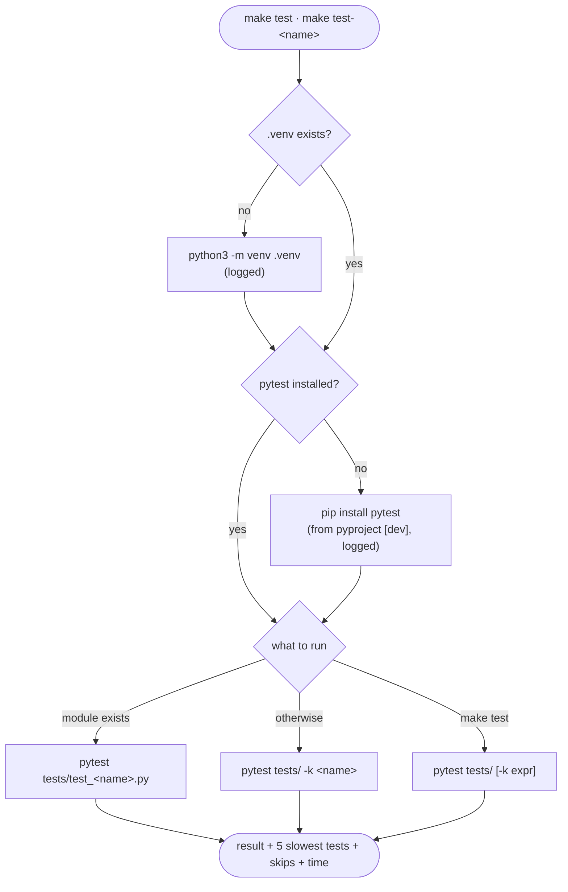

## 🤝 Contributing

PRs welcome — especially for Hacktoberfest! Ideas:

- Speaker diarization
- LLM-based summaries (optional flag)
- More output formats (e.g. Anki)
- Better Windows support / GUI wrapper

```bash
git clone https://github.com/lucasrafaldini/audio-brief.git
cd audio-brief && ./install.sh
```

Open an issue before large changes so we can align on scope.

See also: [CONTRIBUTING.md](CONTRIBUTING.md) · [CODE_OF_CONDUCT.md](CODE_OF_CONDUCT.md) · [SECURITY.md](SECURITY.md) · [LICENSE](LICENSE)

## 📜 License

MIT
