# 🎧 audio-brief

> 🌐 [English](README.md) · **Português (Brasil)** · [Español](README.es.md)

[](https://hacktoberfest.com)
[](https://www.python.org)
[](LICENSE)

Grave ou transcreva áudio com **OpenAI Whisper** e receba automaticamente um
**resumo**, um **mapa mental**, **palavras-chave** e transcrições prontas
(`.txt`, `.srt`, `.vtt`, `.json`) — tudo em um único comando. Sem chaves de API,
funciona offline (após o primeiro download do modelo).

Funciona em **Linux** e **macOS**.

## ✨ Recursos

- 🎙️ Grave do microfone ou transcreva arquivos de áudio existentes
- 🌍 Detecção automática de idioma (ou force com `--language`)
- 🧠 Resumo extrativo, extração de palavras-chave e mapas mentais (Markmap + Mermaid)
- 📄 Legendas em SRT/VTT + `report.md` e `report.html` tudo-em-um
- 🔗 Nota pronta para o Obsidian (`obsidian.md`) com callout de resumo, `[[wiki-links]]` para as principais palavras-chave e uma árvore de tópicos com timestamps para gravações longas com vários assuntos (ex.: grupos de conversa)
- 🗣️ Dois motores de fala: Whisper (preciso, muitos idiomas) ou PocketSphinx (pequeno, totalmente offline, inglês; `--engine pocketsphinx`)
- 📊 Benchmarks de velocidade e qualidade dos tópicos (`make bench`, [resultados](benchmarks/RESULTS.md))
- 🩺 Comando `doctor` verifica seu ambiente (Whisper, ffmpeg, microfone)
- ⚡ Processamento paralelo: vários arquivos (e gravações longas, divididas nas pausas) são transcritos por processos de trabalho dimensionados pela sua CPU e memória; cada arquivo é resumido assim que fica pronto (`--jobs auto`, [detalhes](#processamento-paralelo---jobs))
- 🖥️ CLI amigável: padrões sensatos, zero perguntas quando usado em pipe/CI

## 🚀 Início rápido

Requer **Python 3.10+** e **ffmpeg** (o Whisper usa para ler os arquivos de áudio;
`brew install ffmpeg` no macOS, `sudo apt install ffmpeg` no Debian/Ubuntu).

```bash
git clone https://github.com/lucasrafaldini/audio-brief.git
cd audio-brief
./install.sh          # cria .venv, instala audio-brief + Whisper (PyTorch: download de 1-3 GB)
```

O `install.sh` mostra cada etapa com a duração e verifica o resultado; se algo falhar,
a última linha diz a etapa e como resolver (falta de `python3-venv`, Python antigo,
ffmpeg ausente...). `./install.sh --dev` adiciona o pytest, `--bench` as ferramentas
de benchmark. No Linux, o PyTorch padrão do pip inclui CUDA (o ambiente fica com cerca
de 5-6 GB); para instalar só para CPU rode antes `python3 -m venv .venv &&
.venv/bin/pip install torch --index-url https://download.pytorch.org/whl/cpu`.


Instalação leve: `./install.sh --engine pocketsphinx` (ou `make setup-light`) usa o
PocketSphinx no lugar do Whisper: cerca de 70 MB instalados em cerca de um minuto em vez de
5-6 GB, só inglês e bem menos preciso em conversas (veja
[Motores de reconhecimento de fala](#motores-de-reconhecimento-de-fala)). `--engine both`
instala os dois.

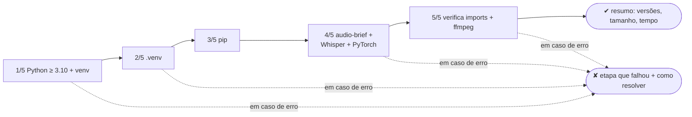


Depois:

```bash
./audio-brief transcribe reuniao.mp3       # escolhe modelo/idioma interativamente
./audio-brief transcribe reuniao.mp3 --model base --language pt
./audio-brief record 120                    # grava 2 minutos, depois transcreve
```

Após o `install.sh`, você também pode adicionar o venv ao seu PATH e usar o
comando diretamente:

```bash
export PATH="$PWD/.venv/bin:$PATH"
audio-brief --help
```

### Outras formas de instalar

```bash
pip install '.[whisper]'          # no ambiente atual (motor Whisper)
pip install '.[pocketsphinx]'     # ou o motor leve PocketSphinx (os dois: '.[whisper,pocketsphinx]')
pipx install '.[whisper]'         # instalação isolada do CLI
```

Um `pip install .` simples não instala nenhum motor de fala (os recursos de texto não precisam).

## 📖 Uso

```
audio-brief record [segundos] [--engine E] [--model M] [--language L] [--out DIR] [--keep-raw] [--min-chars N]
audio-brief transcribe <arquivo> [arquivo2 ...] [--jobs N|auto] [--split-long|--no-split-long] [--engine E] [--model M] [--language L] [--out DIR] [--min-chars N]
audio-brief doctor
audio-brief --version
```

| Opção | Significado |
|--------|---------|
| `--engine E` | `whisper` (padrão; ou `$AUDIO_BRIEF_ENGINE`) ou `pocketsphinx` (leve, offline, só inglês). Veja [Motores de reconhecimento de fala](#motores-de-reconhecimento-de-fala) |
| `--model` | `tiny` (rápido/impreciso) → `base` → `small` → `medium` → `large`/`turbo` (preciso, mais lento); só Whisper |
| `--language` | Código ISO de 2–3 letras (ex.: `en`, `pt`, `es`). Pula a pergunta; detecta automático se não definido |
| `--out DIR` | Escolhe o diretório de saída |
| `--jobs N\|auto` | Processos de trabalho para o reconhecimento de fala (só `transcribe`). Padrão `auto`: escolhido pelos núcleos de CPU, memória livre e tamanho do motor; `1` = um arquivo depois do outro. Veja [Processamento paralelo](#processamento-paralelo---jobs) |
| `--split-long` / `--no-split-long` | Divide arquivos longos nas pausas para que vários processos os compartilhem (padrão: ligado para PocketSphinx, desligado para Whisper) |
| `--summary-n N` | Máximo de frases no resumo (padrão: 8) |
| `--keywords-n N` | Máximo de palavras-chave extraídas (padrão: 15) |
| `--min-chars N` | Ignora frases com menos de N caracteres ("Tá.", "kkk") no resumo, mapa mental e árvore de tópicos (padrão: 20, `0` mantém todas) |
| `--keep-raw` | Mantém o `.wav` gravado dentro da pasta de saída (só `record`) |

Rode `audio-brief doctor` primeiro se algo não funcionar — ele verifica
Python, os motores de fala, ffmpeg, backends de gravação e (no macOS) lista os dispositivos de áudio.

Exemplos:

```bash
# um arquivo, inglês, modelo medium
audio-brief transcribe aula.wav --model medium --language en

# uma pasta de gravações, processos escolhidos automaticamente (o plano é impresso antes)
audio-brief transcribe reunioes/*.mp3

# no máximo dois por vez, p.ex. para manter a máquina utilizável
audio-brief transcribe a.mp3 b.mp3 c.mp3 --jobs 2
```

Quando executado interativamente, você será perguntado sobre idioma e modelo
uma vez; quando usado em pipe (CI, scripts), usa auto-detect + `base`.

### Relatório de processamento

Depois de cada arquivo o audio-brief mostra o que fez e quanto tempo levou, por
exemplo para um grupo de conversa de 9.605 palavras (o tempo do Whisper depende do
modelo e da máquina):

```
--- Processing report ---
  transcription (whisper): …s for …s of audio (…x real time)
  text: 9,605 words in 736 segments (transcript had little punctuation: analysed per speech segment)
  found: 8 top-level topics, 9 mind-map branches, 11 files
  analysis + writing: 0.33s  (units 3 ms, specificity 91 ms, summary 29 ms, keywords 24 ms, topic tree 45 ms, timestamps 2 ms, mind map 37 ms, grouping 5 ms, writing files 92 ms)
```

## 📂 Saídas

Os arquivos caem em `audio-brief-<timestamp>/` no diretório atual (ou `--out DIR`),
uma pasta `run-<n>/` por arquivo transcrito, numerada na ordem em que os arquivos foram passados:

| Arquivo | Conteúdo |
|------|---------|
| `transcript.txt` | Transcrição em texto com timestamps |
| `transcript.srt` / `.vtt` | Legendas |
| `transcript.json` | Dados brutos dos segmentos |
| `summary.md` | Frases-chave, ranqueadas (fragmentos com menos de 20 caracteres são ignorados) |
| `keywords.md` | Principais palavras-chave e expressões de duas palavras recorrentes, com quantas vezes aparecem |
| `mindmap.md` | Mapa mental: tópico › subtópico › frase (cole em [markmap.js.org](https://markmap.js.org)) |
| `mindmap.mmd` | Mapa mental em Mermaid ([mermaid.live](https://mermaid.live)) |
| `report.md` | Tudo em um único Markdown |
| `report.html` | Mesmo relatório como página web autocontida (sem precisar de visualizador) |
| `obsidian.md` | Nota do Obsidian: callout `> [!summary]`, `[[wiki-links]]` para as 10 principais palavras-chave, árvore `## Topics` de wiki-links aninhados com timestamps, transcrição recolhível |

## 🏗️ Arquitetura

### Estrutura do projeto

Tanto `./audio-brief` (o launcher do repositório) quanto o comando
`audio-brief` instalado chegam em `audio_brief/cli.py`. A CLI cuida da gravação e
do reconhecimento de fala (`asr.py`; `parallel.py` distribui arquivos muitos ou longos
entre processos de trabalho); todo o processamento de texto é offline e sem dependências. A pasta
`benchmarks/` mede sua velocidade e qualidade (veja [Benchmarks](#-benchmarks)).

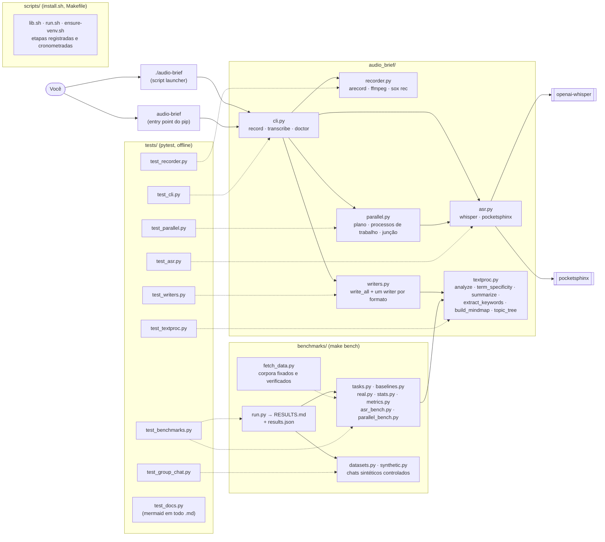

### Pipeline de processamento

`writers.write_all()` chama `textproc.analyze()` uma vez por arquivo. Ela escolhe as
unidades de análise (frases, ou os segmentos do Whisper quando a transcrição quase não
tem pontuação, porque aí as frases só podem ser cortadas em blocos de 30 palavras),
pontua a especificidade de cada palavra e calcula resumo, palavras-chave, árvore de
tópicos (com timestamps) e mapa mental a partir disso. `--min-chars` (padrão 20)
mantém fragmentos curtos fora do resumo, do mapa mental e da árvore de tópicos.

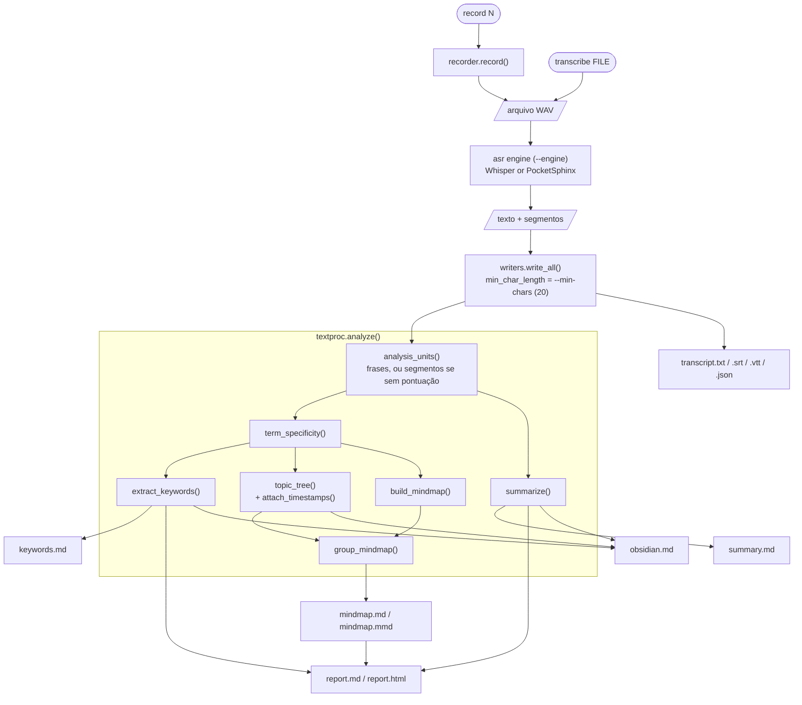

### Motores de reconhecimento de fala

`audio_brief/asr.py` coloca os dois motores atrás de uma única interface que devolve texto,
segmentos com tempo, idioma e duração; o resto do pipeline não sabe qual rodou. O Whisper
continua sendo o padrão. O PocketSphinx (CMU Sphinx, licença BSD) é um reconhecedor
estatístico independente e mais antigo, com um modelo de inglês americano embutido: não
precisa de PyTorch nem de download depois de instalado, mas só reconhece inglês, não põe
pontuação (o audio-brief então analisa por segmento de fala) e erra bem mais, sobretudo em
conversas e áudio de telefone. O áudio chega do ffmpeg em fluxo; a detecção de voz só decide
onde uma fala termina (numa pausa de 0,5 s ou após 20 s): todo trecho é decodificado, então a
fala que o detector perde não se perde. Cada fala é então decodificada inteira, o que é mais
preciso que decodificar ao vivo.

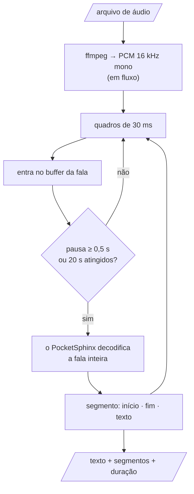

Medido em fala real (benchmarks/RESULTS.md seção 6):

| Motor | Palavras erradas: fala lida | Palavras erradas: ligação | Velocidade | Memória | Tamanho instalado |
|---|---|---|---|---|---|
| PocketSphinx 5.1.1 | 27% [20-32%] | 81% | 0,80× o tempo real | 169 MB | 39 MB |
| Whisper (tiny/base) | não medido aqui: os pesos do modelo não puderam ser baixados no ambiente do benchmark; rode `make bench ARGS="--only asr"` numa máquina com internet para comparar | | | | 5.5 GB |

O conjunto de teste é pequeno (152 palavras transcritas): as taxas de fala lida e
de ligação têm intervalos largos e são indicativas. Use o PocketSphinx onde o Whisper não
roda (sem GPU ou espaço em disco, sem rede no primeiro uso) e o áudio é inglês claro; caso
contrário, prefira o Whisper.

### Processamento paralelo (`--jobs`)

`audio-brief transcribe` com vários arquivos, ou com um arquivo longo, planeja o
trabalho antes de começar e imprime o plano com o motivo de cada decisão
(`audio_brief/parallel.py`):

- **Processos, não threads.** O reconhecimento de fala é código de extensão Python
  limitado pela CPU que segura o GIL do Python: duas threads de PocketSphinx rodaram
  1,02× mais rápido que uma. Por isso o reconhecimento roda em processos de trabalho,
  cada um carregando seu motor uma vez. Threads só são usadas para esperar o
  ffprobe/ffmpeg (ler durações, achar pausas).
- **Quantos processos.** `--jobs auto` (o padrão) usa o menor entre o que os núcleos de
  CPU e a memória livre permitem: ~0,25 GB por processo PocketSphinx (medido) e, para
  o Whisper, os tamanhos de modelo publicados pela OpenAI (1 GB para `tiny`/`base` até
  10 GB para `large`; não medidos aqui). Cada processo Whisper também recebe
  `núcleos ÷ processos` threads do PyTorch, para não disputarem núcleos.
- **Arquivos longos são divididos nas pausas** quando processos ficariam ociosos (uma
  gravação longa, ou uma bem mais longa que as outras): cortes perto de cada 1-10
  minutos, movidos para a pausa mais próxima (`silencedetect` do ffmpeg) para não cortar
  palavras, depois reunidos com os tempos deslocados. Ligado por padrão no PocketSphinx,
  cuja precisão com divisão é medida abaixo; opcional no Whisper (`--split-long`), onde
  não é medida.
- **Trabalho mais longo primeiro**, para que um arquivo longo não comece por último e
  deixe todos esperando.
- **Os resumos se sobrepõem ao reconhecimento.** Assim que todas as partes de um arquivo
  voltam, o processo principal o analisa e grava seus arquivos enquanto os processos
  continuam transcrevendo o resto. A análise é rápida perto do reconhecimento (0,33 s
  para um chat de 9.605 palavras, veja [Relatório de processamento](#relatório-de-processamento)),
  então não precisa de processos próprios.
- **Progresso e falhas.** Uma linha por unidade concluída com estimativa de término; um
  arquivo que falha é relatado e os outros terminam mesmo assim (código de saída 1).

Com um arquivo que não precisa ser dividido, ou `--jobs 1`, os arquivos são processados
um depois do outro no processo principal, exatamente como antes.

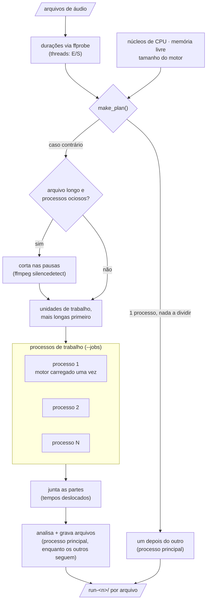

Medido com PocketSphinx em 4 núcleos ([RESULTS.md seção 7](benchmarks/RESULTS.md#7-parallel-processing)):

| Trabalho | Um processo | `--jobs auto` | Aceleração | Precisão |
|---|---:|---:|---:|---|
| Lote: 8 gravações reais, 4,7 min de áudio | 148 s | 38 s (4 processos, 10 unidades: arquivos longos divididos) | **3,9×** | veja a próxima linha |
| Uma gravação, 4,6 min, toda transcrita | 128 s | 57 s (5 partes em 4 processos) | **2,2×** | taxa de erro de palavras 60,5% inteira, 57,4% dividida |

Dividir muda quais palavras o PocketSphinx produz (29% das palavras diferem entre a
transcrição inteira e a dividida) sem piorá-la em relação à referência; é uma gravação só,
então trate como indicativo. As acelerações são execuções únicas numa máquina virtual
compartilhada: uma execução anterior do mesmo benchmark deu 3,8× e 2,8×. A aceleração paralela
do Whisper não foi medida (seus pesos não puderam ser baixados no ambiente do benchmark).

### Filtro de fragmentos no resumo (`min_char_length`)

`textproc.summarize()` (também disponível como `textproc.extract_summary()`)
nunca escolhe frases com menos de `min_char_length` caracteres (padrão `20`),
então muletas como "Tá." ou "Então, né." ficam fora dos resumos. Frases curtas
ainda contam nas frequências de palavras-chave. Use `min_char_length=0` (CLI:
`--min-chars 0`) para desligar o filtro.

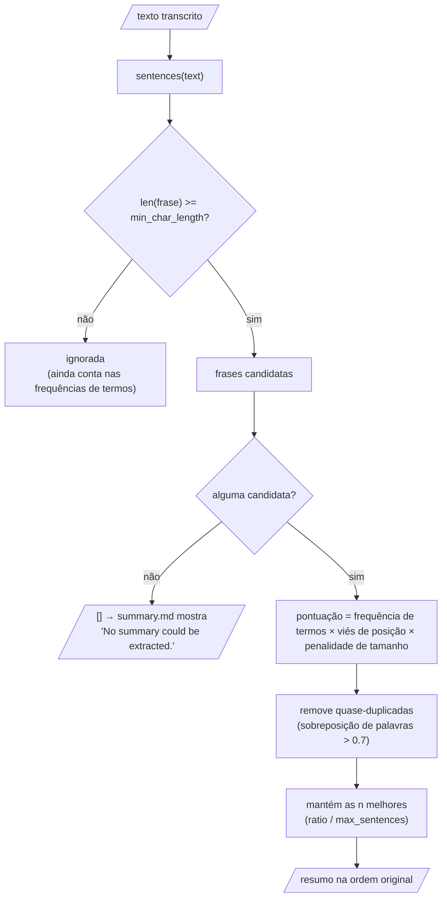

### Palavras de tópico vs palavras genéricas (especificidade)

Só a frequência não separa tópico de enchimento: num grupo de conversa, "needs",
nomes e dias da semana são tão frequentes quanto "hotel". Mas uma conversa fica num
assunto por um tempo, então uma palavra de tópico prevê do que tratam as frases
*vizinhas*, enquanto uma palavra genérica aparece perto de qualquer coisa (coesão
lexical, a ideia do TextTiling). `textproc.term_specificity()` pontua cada palavra
por quão diferentes as palavras a até 2 unidades dela são da transcrição inteira
(divergência KL, suavizada para não supervalorizar palavras raras). No chat de 2.000
mensagens do benchmark todo substantivo de tópico pontua acima de toda palavra
genérica (0,19 ou mais vs 0,11 ou menos). As palavras-chave são ordenadas
principalmente por ela (veja abaixo), a árvore de tópicos só usa palavras de tópico e o
mapa mental pesa as palavras por ela.

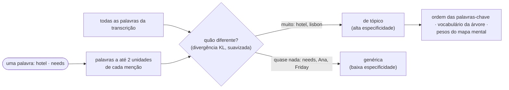

### Palavras-chave e expressões

`textproc.extract_keywords()` retorna palavras e expressões de duas palavras com quantas
vezes elas realmente aparecem. Uma expressão são duas palavras de conteúdo *vizinhas*
dentro de uma frase que aparecem pelo menos duas vezes, então nada é costurado através
de um ponto final ou de um "the" pulado. Uma expressão que só continua outra já
escolhida ("scored twice" em "striker scored twice") é ignorada, e uma palavra sai
quando uma expressão responde por pelo menos 80% dos seus usos ("bank" → "bank api").
Elas são ordenadas por menções × (0,12 + 0,88 × especificidade), então "hotel" vence um
"needs" mais frequente, enquanto o assunto principal da gravação, mencionado em todo lugar
e por isso *não* específico, continua chegando ao topo (sem essa parcela de 12% de
frequência, o assunto dos artigos reais da Wikipédia ficava bem mais abaixo: MRR 0,44 em
vez de 0,75). A contagem mostrada é sempre a real. Essas também são os `[[wiki-links]]`
do `obsidian.md`. Palavras comuns com pouco conteúdo (a lista SMART de 571 palavras:
"first", "used", "however" ...) são ignoradas, e um termo mencionado pela primeira vez nos 5%
iniciais do texto ganha até o dobro de peso, porque quem fala costuma apresentar o assunto
no começo.

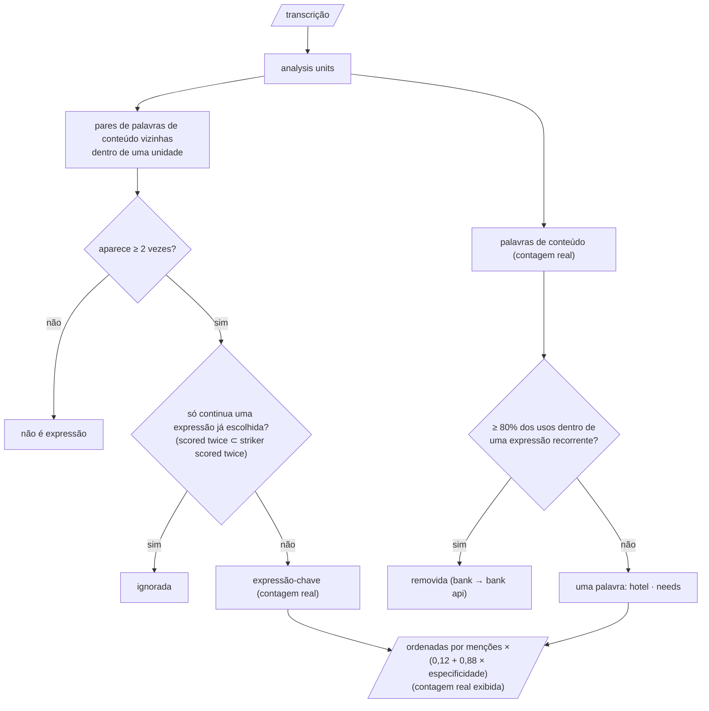

### Agrupamento do mapa mental

`textproc.build_mindmap()` lê as unidades em ordem. Cada uma entra no grupo com as
palavras mais parecidas (similaridade de cosseno ≥ 0,3, com palavras pesadas pela
especificidade para que enchimento compartilhado não decida) ou começa um novo; um
índice de palavras mantém o trabalho linear, e um grupo que não recebe frases há 500 unidades (cerca
de uma hora de fala) deixa de aceitar novas, então gravações muito longas também ficam lineares. Depois `group_mindmap()` coloca esses
subtópicos sob os tópicos de primeiro nível da árvore, então os arquivos ficam tópico ›
subtópico › frase (um tópico com um único subtópico lista as frases direto). No chat de
2.000 mensagens do benchmark isso dá 9 ramos para 8 assuntos com 100% de pureza.
Trecho:

```markdown
## oven / lasagna / basil
### curry / lasagna / recipe
#### I am not sure the spices works with the lasagna.
#### Did anyone check the curry for the lasagna yet.
### basil / oven / spices
#### The spices looks good but the basil is a problem.
```

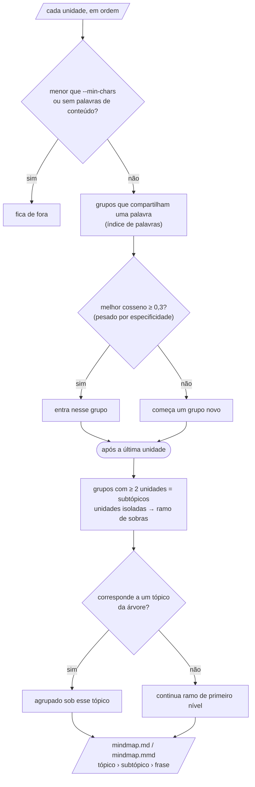

### Nota do Obsidian (`obsidian.md`)

`writers.write_obsidian_note(output_dir, text, summary, keywords)` reaproveita o
resumo e as palavras-chave de `write_all`. As palavras-chave são deduplicadas e
limpas de caracteres que o Obsidian não aceita em links (`[ ] | # ^ \ / : * ? " < >`).

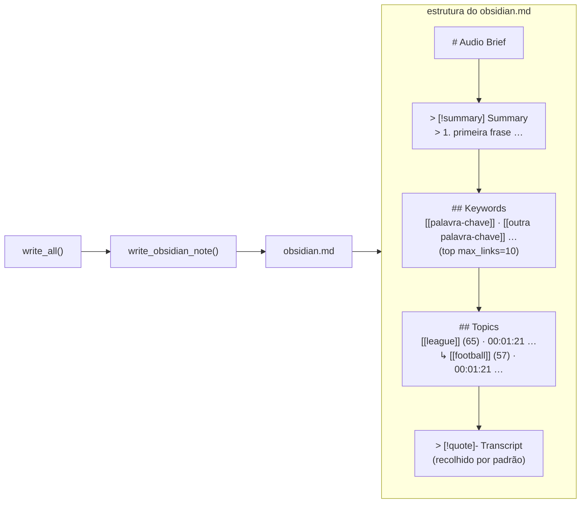

### Árvore de tópicos (grupos de conversa e gravações longas)

Uma gravação longa que pula de assunto em assunto (um grupo de conversa, uma call semanal)
ganha uma seção `## Topics` no `obsidian.md`: cada assunto vira um ramo de `[[wiki-links]]`
aninhados com o número de unidades que o mencionam e os primeiros timestamps em que aparece.
`textproc.topic_tree()` monta um grafo das palavras-chave de tópico (expressões como
`[[bank api]]` ficam inteiras), ligando dois termos por quanto mais que o acaso eles aparecem
a até uma unidade um do outro (PMI positivo, pares vistos juntos pelo menos 3 vezes). A
detecção de comunidades de Louvain (Blondel et al. 2008) divide esse grafo em tópicos, então
**o número de tópicos vem do texto**. Comunidades que cobrem menos de 5% das unidades de
tópico saem (fragmentos e palavras genéricas), comunidades que aparecem nos mesmos trechos do
texto (1,5× mais que o acaso) viram subtópicos de um assunto, e dentro de um tópico um termo
fica sob um mais frequente quando 70% das suas unidades o têm por perto. Um exemplo real, do
benchmark: três artigos da Wikipédia (Academy Awards, Aardvark, Algeria) intercalados como
uma conversa:

```markdown
## Topics

- [[awards]] (16)
  - [[members]] (10)
    - [[categories]] (6)
  - [[film]] (12)
  - [[academy]] (9)
    - [[oscar]] (4)
- [[burrows]] (7)
  - [[aardvark]] (10)
    - [[termites]] (5)
  - [[season]] (6)
- [[political]] (6)
  - [[islamic]] (7)
  - [[bouteflika]] (5)
- [[ceremony]] (6)
- [[algeria]] (6)
```

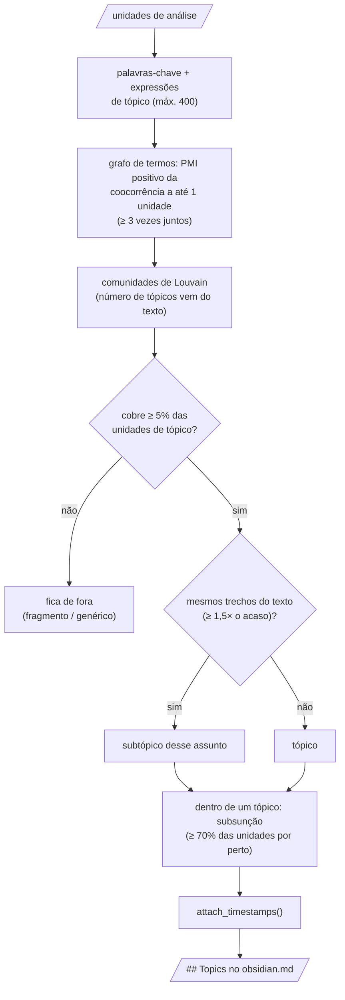

Como os tópicos são wiki-links simples, gravações salvas no mesmo vault do Obsidian
se conectam pelos assuntos em comum (backlinks e visão de grafo):

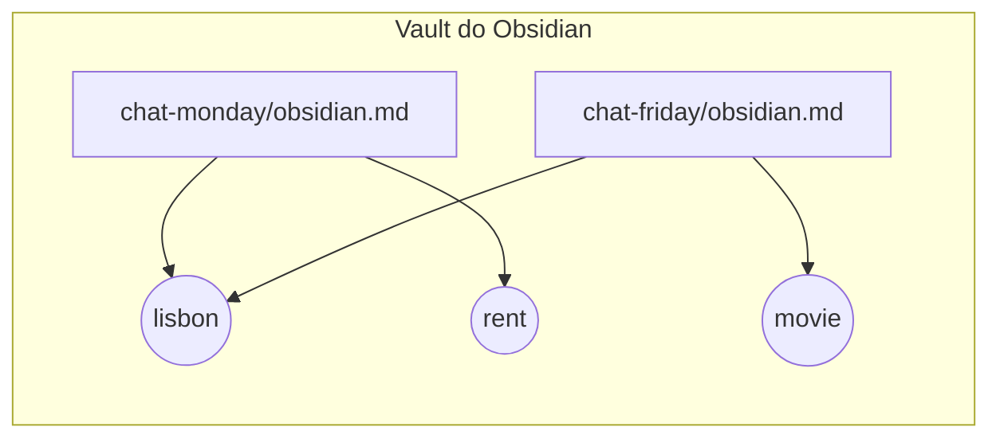

Nas transcrições separadas para teste isso dá 0,9-1,5 tópicos de primeiro nível por
assunto real na Wikipédia (2,9 nos posts da Usenet) e nenhum tópico genérico no primeiro
nível. Como mostra o exemplo, um assunto ainda pode se dividir em dois (Academy Awards: awards e
ceremony), um rótulo pode ser uma palavra característica em vez do nome do assunto ("burrows"
para o aardvark) e, com muitos assuntos, alguns se juntam (pureza 65% com 8 tópicos).

## ⚙️ Backends de gravação

Escolhido automaticamente: `arecord` (Linux/ALSA) → `ffmpeg` (macOS via
avfoundation, Linux via ALSA) → `sox rec`. Force um e escolha o microfone:

```bash
AUDIO_BRIEF_RECORDER=ffmpeg AUDIO_BRIEF_MIC=1 audio-brief record 60
# listar entradas de áudio no macOS:
ffmpeg -f avfoundation -list_devices true -i ''
```

## 💡 Tamanho dos modelos

| Modelo | Tamanho | Velocidade (CPU) | Qualidade |
|-------|------|-------------|---------|
| `tiny` | ~75 MB | mais rápido | impreciso |
| `base` | ~150 MB | rápido | ok para um brief |
| `small` | ~500 MB | médio | bom |
| `medium` | ~1,5 GB | lento | ótimo |
| `large`/`turbo` | ~3 GB | mais lento | melhor |
| PocketSphinx (`--engine pocketsphinx`) | ~40 MB, sem PyTorch | ~0,8× o tempo real | só inglês; ~27% de palavras erradas em fala lida limpa, ~81% numa ligação |

## 🍎 App macOS (opcional)

```bash
.venv/bin/pip install py2app
.venv/bin/python setup.py py2app -A
# -> dist/audio-brief.app
```

## 📊 Benchmarks

Qualidade e velocidade são medidas em **dados públicos e reais** com respostas conhecidas, contra
métodos estabelecidos, com intervalos de confiança de 95%. Os parâmetros são escolhidos numa
metade dos corpora e todo número de qualidade abaixo vem da **outra metade, reservada**.
[`benchmarks/RESULTS.md`](benchmarks/RESULTS.md) tem todas as tabelas e gráficos,
[`benchmarks/results.json`](benchmarks/results.json) cada rodada, e
[`benchmarks/METHODOLOGY.md`](benchmarks/METHODOLOGY.md) como cada número é produzido.

```bash
make bench          # ~15 min: instala as ferramentas [bench], baixa os dados e roda tudo
make bench-quick    # rodada rápida de verificação (poucas rodadas para conclusões)
make bench ARGS="--only asr"        # remede só o reconhecimento de fala (os outros resultados são mantidos)
make bench ARGS="--only parallel"   # remede só o processamento paralelo
```

Dados (baixados do PyPI/npm em versões fixas, com checksums verificados): 106 artigos da
Wikipédia, 200 posts da Usenet (20 Newsgroups), 233 discursos do Estado da União e fala real
gravada (trechos de audiolivro, uma ligação telefônica). As transcrições com vários tópicos são
montadas com frases reais de várias fontes (Choi 2000), então o tópico real de cada frase é
conhecido.

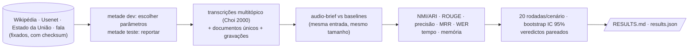

Principais resultados (metade de teste; valores: média [IC 95%]):

| Tarefa | Dados | Métrica | audio-brief | Baseline mais forte | Veredicto (vitórias/empates/derrotas) |
|---|---|---|---|---|---|
| Descoberta de tópicos (mapa mental) | Wikipédia, 3 tópicos | NMI | 0,53 [0,50; 0,56] | TF-IDF + k-means (true k): 0,41 [0,37; 0,45] | **melhor** (17/0/3) |
| Descoberta de tópicos (mapa mental) | Wikipédia, 5 tópicos | NMI | 0,58 [0,55; 0,61] | TF-IDF + k-means (true k): 0,41 [0,37; 0,45] | **melhor** (20/0/0) |
| Descoberta de tópicos (mapa mental) | Wikipédia, 8 tópicos | NMI | 0,56 [0,53; 0,59] | TF-IDF + k-means (true k): 0,41 [0,38; 0,44] | **melhor** (20/0/0) |
| Descoberta de tópicos (mapa mental) | Usenet, 2 tópicos | NMI | 0,15 [0,14; 0,16] | TF-IDF + k-means (true k): 0,10 [0,08; 0,12] | **melhor** (15/0/5) |
| Precisão das palavras-chave | Wikipédia, 5 tópicos | precision@15 | 84% [79%; 88%] | YAKE: 88% [84%; 92%] | **sem diferença clara** (6/3/11) |
| Assunto principal nas palavras-chave | 38 artigos da Wikipédia | MRR | 0,82 [0,72; 0,91] | YAKE: 0,90 [0,82; 0,97] | **sem diferença clara** (3/24/11) |
| Resumo | 41 introduções da Wikipédia | ROUGE-1 | 0,32 [0,30; 0,34] | LexRank: 0,34 [0,32; 0,35] | **sem diferença clara** (16/0/25) |

O que mudou nesta versão (mesma metade de teste, mesmo harness, código anterior → atual):

| Transcrições | Tópicos de 1º nível por tópico real | Tópicos genéricos no 1º nível | Pureza da árvore | NMI do mapa mental | Precisão das palavras-chave (YAKE) |
|---|---:|---:|---:|---:|---:|
| Wikipédia, 3 tópicos | 3,25 → **1,48** | 39% → **0%** | 90% → **86%** | 0,50 → **0,53** | 86% → **85%** (89%) |
| Wikipédia, 5 tópicos | 2,17 → **1,09** | 33% → **0%** | 84% → **82%** | 0,54 → **0,58** | 83% → **84%** (88%) |
| Wikipédia, 8 tópicos | 1,64 → **0,90** | 18% → **0%** | 67% → **65%** | 0,54 → **0,56** | 76% → **77%** (86%) |
| Usenet, 2 tópicos | 7,53 → **2,90** | 10% → **0%** | 87% → **85%** | 0,13 → **0,15** | 75% → **78%** (91%) |

Assunto principal nas palavras-chave (MRR): 0,73 → **0,82** (YAKE 0,90). Tempo de análise
para 1.000.000 de palavras: 137 s → **34 s**; expoente de escala 1,33 → **1,12**
(1 = linear). Contrapartidas: a pureza da árvore ficou 0,02-0,04 menor, e a precisão das
palavras-chave continua 4-13 pontos atrás do YAKE (na metade dev parecia empatada: a metade
reservada é o motivo de reportar as duas).

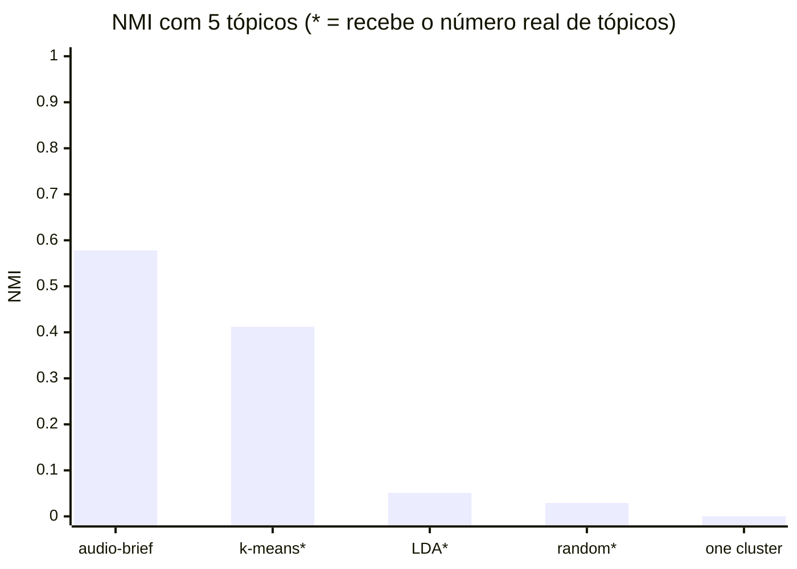

Velocidade em discursos reais: um discurso (mediana de 7.006 palavras) é analisado numa mediana
de **206 ms**; 300.000 palavras levam 8,4 s. O reconhecimento de fala é medido à
parte: veja [Motores de reconhecimento de fala](#motores-de-reconhecimento-de-fala).

O que isso mostra:

- **Agrupar por tópico é o ponto mais forte**: NMI ≈ 0,58 nas misturas da Wikipédia, melhor que TF-IDF + k-means e LDA mesmo recebendo o número real de tópicos; os posts informais da Usenet continuam difíceis (NMI ≈ 0,15).
- **A árvore de tópicos agora tem cerca de um tópico de primeiro nível por assunto** (0,9-1,5 na Wikipédia, 2,9 na Usenet, antes até 3,3 e 7,5) e nenhum tópico genérico no primeiro nível, ao custo de uma pureza um pouco menor.
- **As palavras-chave ficam atrás do YAKE na média** (precisão temática 4-13 pontos menor; MRR do assunto principal 0,82 vs 0,90), embora nesta metade de teste nenhuma das diferenças seja estatisticamente clara.
- **Os resumos empatam com os métodos extrativos clássicos** (sem diferença clara para TextRank e LexRank).
- **Fala**: o PocketSphinx erra cerca de 27% das palavras em fala lida limpa e 81% numa ligação; o Whisper não pôde ser medido offline.
- **Processamento paralelo**: em 4 núcleos, 8 gravações são transcritas 3,9× mais rápido que com um processo, e uma gravação de 4,6 minutos 2,2× mais rápido quando dividida nas pausas, sem perda de precisão (execuções únicas).

## 🧪 Testes

A suíte de testes roda offline (o Whisper é simulado), então não precisa da instalação
completa: num clone novo, `make test` cria sozinho um `.venv` leve com o pytest (sem
mexer no Python do sistema) e reaproveita o ambiente do `make setup` quando existe.
Cada execução registra o interpretador, o comando exato, os 5 testes mais lentos, os
testes pulados com o motivo e o tempo total. `PYTHON=...` usa outro interpretador
(verificado, nunca modificado); `make help` lista todos os alvos.

| Comando | Executa |
|---------|------|
| `make test` | A suíte inteira |
| `make test-writers` | Um módulo, `tests/test_writers.py` (também `cli`, `group_chat` / `group-chat`, `recorder`, `textproc`, `asr`, `parallel`, `docs`, `benchmarks`) |
| `make test-obsidian` | Todo teste cujo nome contém `obsidian`, em todos os módulos |
| `make test K="topic_tree and not empty"` | Qualquer expressão `-k` do pytest |
| `make test-list` | Lista todos os ids de teste |
| `make test-textproc ARGS="-x --lf"` | Flags extras do pytest para qualquer alvo |

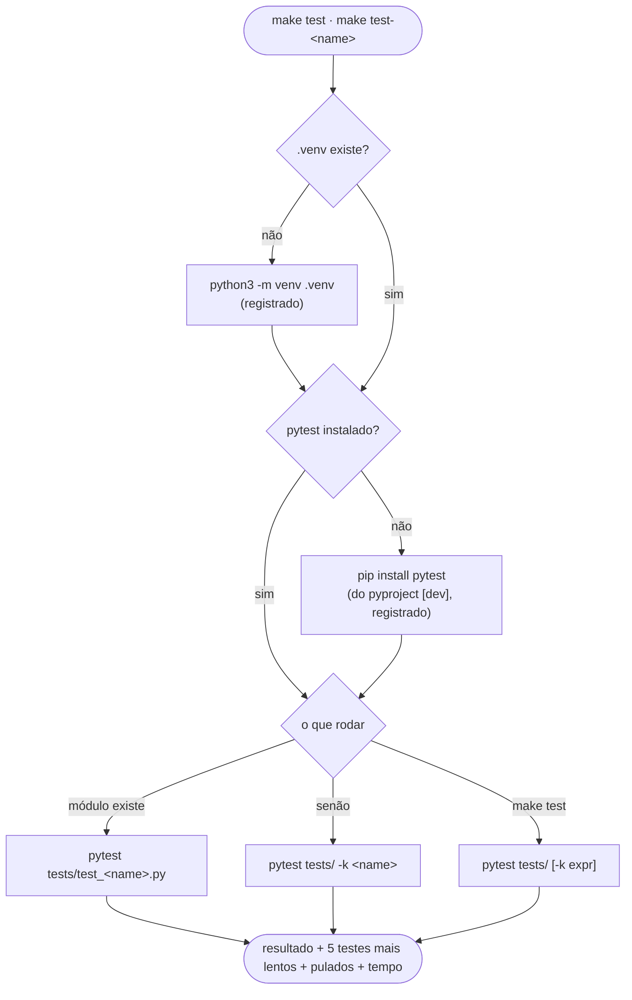

## 🤝 Contribuindo

PRs são bem-vindos — especialmente no Hacktoberfest! Ideias:

- Diários de locutores (speaker diarization)
- Resumos via LLM (flag opcional)
- Mais formatos de saída (ex.: Anki)
- Melhor suporte a Windows / interface gráfica

```bash
git clone https://github.com/lucasrafaldini/audio-brief.git
cd audio-brief && ./install.sh
```

Abra uma issue antes de mudanças grandes para alinharmos o escopo.

Veja também: [CONTRIBUTING.md](CONTRIBUTING.md) · [CODE_OF_CONDUCT.md](CODE_OF_CONDUCT.md) · [SECURITY.md](SECURITY.md) · [LICENSE](LICENSE)

## 📜 Licença

MIT
