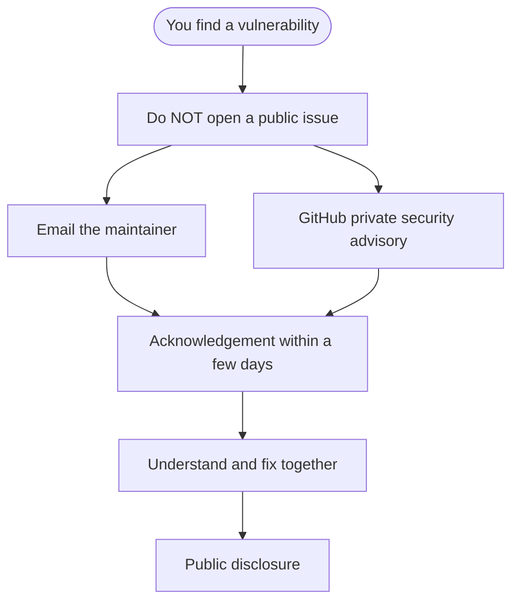

# Security Policy

## Reporting a Vulnerability

Please do **not** open a public issue for security vulnerabilities.
Instead, email the maintainer or open a private security advisory via
GitHub (Security → Advisories → "Report a vulnerability"):

https://github.com/lucasrafaldini/audio-brief/security/advisories/new

You can expect an acknowledgement within a few days. We'll work with you
to understand and fix the issue before any public disclosure.

