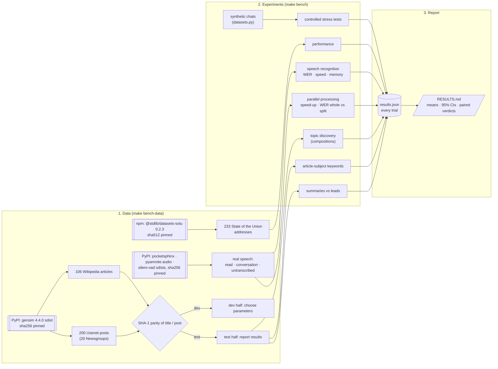
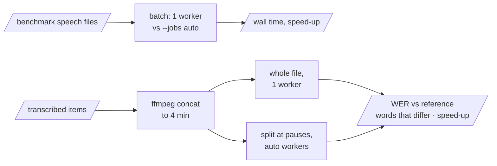
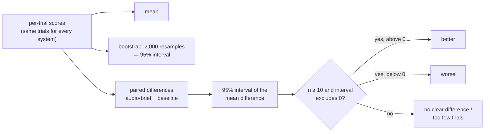

# Benchmark methodology

This document explains how every number in [RESULTS.md](RESULTS.md) is produced:
which data, which tasks, which metrics, which baselines, and how uncertainty is
reported. The code is in this folder; `make bench` runs everything.

## 1. Data

All corpora are public, downloaded from package registries at pinned versions,
and verified by checksum before use (`fetch_data.py`). Nothing is
hand-edited; cleaning rules are below and apply to every system equally.

| Corpus | Source | Size | Licence | Used for |
|---|---|---|---|---|
| Wikipedia | 106 English articles in the test fixtures of `gensim` 4.4.0 (sdist, sha256 `a3f5b626…`) | 403,601 words after cleaning | CC BY-SA 3.0 | topic discovery, summaries, keywords |
| Usenet | 200 posts from alt.atheism and sci.space, 20 Newsgroups sample in the same archive | 39,543 words | research corpus (Lang, 1995) | topic discovery on informal text |
| State of the Union | 233 addresses, 1790-2021, `@stdlib/datasets-sotu` 0.2.3 (npm, sha512 `QbspCBws…`) | 1,794,884 words | public domain | performance on real speeches |
| Read speech | 5 LibriVox utterances of *Sense and Sensibility* with transcripts, from the test data of `pocketsphinx` 5.1.1 (sdist, sha256 `675778b3…`) | 25 s, 70 words | public domain recordings | speech recognition |
| Conversation | 30 s two-speaker telephone call with a time-stamped transcript (`sample.wav` + `sample.stm` of `pyannote.audio` 4.0.7, sha256 `3a903dfb…`) | 13 turns | shipped with an MIT package; origin not documented there | speech recognition |
| Untranscribed speech | 60 s and 169 s recordings from `silero-vad` 6.2.3 (sha256 `d7a23b09…`) | 3.8 min | shipped with an MIT package | speech-recognition speed only |

Speech files are downloaded and used locally; none is redistributed in this repository
(the single test fixture in `tests/data/` is a public-domain LibriVox utterance).

### Dev and test halves

Wikipedia articles and Usenet posts are split in two by the parity of the SHA-1 of the
title (post text): **dev** (57 articles, 92 posts) is used to choose parameters, **test**
(49 articles, 92 posts) only to report results. Every number in RESULTS.md sections
1-4 comes from the test half.

Cleaning:

- **Wikipedia**: wikitext to prose: templates, tables, references, files,
  categories, lists and headings removed; links reduced to their text; HTML
  entities decoded. Sections "See also", "References", "External links",
  "Notes", "Further reading", "Bibliography" and "Sources" are dropped. The
  *lead* (text before the first heading) is kept separately.
- **Usenet**: headers, quoted lines (`>`), attribution lines ("X writes:")
  and signatures are removed, so each post contains only its author's words.
  The label is the post's newsgroup (cross-posts: the one of the two studied).
  The pickle is read with a restricted unpickler that cannot import code.
- **State of the Union**: used as published.

## 2. Experiments

### 2.1 Topic discovery (mind map and topic tree)

**Question**: given a transcript that switches between subjects, does
audio-brief group sentences by subject, and does the topic tree name the
subjects?

**Construction** (Choi, 2000, with topic recurrence): for each trial, *k*
random Wikipedia articles (with at least 60 sentences) contribute a window of 40
consecutive sentences each; the windows are interleaved in blocks of 2-8
sentences of a randomly chosen article, so subjects come back several times,
as in a conversation. For Usenet, 40 posts (20 per group) are interleaved in
blocks of 1-3 posts. Every sentence keeps its true source. Settings: *k* = 3,
5, 8 (Wikipedia) and 2 (Usenet); 20 trials each; seeds are fixed
(`1000 * k + trial`).

The gold sentence split uses a neutral rule (end punctuation followed by a
capital letter), not audio-brief's splitter; audio-brief's units are mapped
back to gold sentences by character offset (`real.align`).

**Metrics**

| Metric | Definition | Range |
|---|---|---|
| NMI | Normalised mutual information between predicted and true clusters (scikit-learn) | 0 = independent, 1 = identical |
| ARI | Adjusted Rand index (scikit-learn) | ≈ 0 = chance, 1 = identical |
| Topic tree coverage | Share of true topics with a top-level branch holding ≥ 2 of their reference words | higher is better |
| Topic tree purity | Share of topical top-level branches whose reference words come from one topic | higher is better |
| Generic top-level topics | Share of top-level branches with no reference word | lower is better |
| Top-level topics per real topic | Topical top-level branches ÷ covered topics (fragmentation) | 1.0 is ideal |
| Topical precision@15 | Share of the top 15 keywords that contain a reference word | higher is better |

audio-brief's prediction for a sentence is its top-level mind-map branch;
sentences it leaves out (too short, or in the leftovers branch) form one extra
cluster, so leaving sentences out is penalised. *Reference words* of a topic are
content words mentioned in ≥ 3 sentences, ≥ 80% of them from that topic: they
are derived from the gold labels only, never from any system's output.

**Baselines**: TF-IDF + k-means and LDA (scikit-learn), both **given the
true number of topics**, which audio-brief is not told; random clusters with
the true *k*; a single cluster. Keyword baselines: frequency ranking (same
stopwords as audio-brief) and YAKE.

### 2.2 Article subject in the keywords

**Question**: does a document's main subject appear at the top of the
keywords? For each Wikipedia article whose title words each occur ≥ 2 times in
the first 2,000 words of the body (76 articles), every system extracts 10
keywords from those 2,000 words. Title words are a *silver standard* for the
subject. Metrics: title recall@10 (share of title words found), hit@10 (any
found) and MRR (1 / rank of the first keyword containing a title word).
Words are compared after Porter stemming for every system. Baselines:
frequency, YAKE, TextRank.

### 2.3 Summaries

For each Wikipedia article with a lead of ≥ 40 words and a body of ≥ 400 words
(first 3,000 words used), every system summarises the **body** and is scored
against the article's **lead**, a human-written summary, with ROUGE-1/2/L F1
(`rouge-score` 0.1.2, Porter stemming). All outputs are cut to the same word
budget (the lead's length, at most 150 words), so longer output cannot win by
length. Baselines: Lead-k (first sentences of the body), random sentences,
TextRank, LexRank.

### 2.4 Performance

State of the Union addresses are joined chronologically and cut at 10k, 30k,
100k and 300k words. For each size: one warm-up run (up to 100k words), then
5/5/3/2 timed runs of `textproc.analyze()` (all text analysis) and of
`writers.write_all()` (analysis + writing the 11 files), each starting with a
cleared term cache. Reported: median and interquartile range, throughput,
per-stage medians (`Analysis.timings`), and peak Python memory from
`tracemalloc` in a separate run. A log-log least-squares fit gives the
scaling exponent (time ∝ words^b; b = 1 is linear). 40 individual addresses
are also timed as realistic single recordings.

### 2.5b Speech recognition

**Question**: how accurate, fast and heavy is each speech-recognition engine on real
recordings? Engines: PocketSphinx 5.1.1 with its bundled US-English model, and Whisper
`tiny` / `base` when their weights are cached or downloadable (otherwise the report marks
them "not measured" with the reason; nothing is estimated).

- **Accuracy**: word error rate, WER = (substitutions + deletions + insertions) /
  reference words, corpus-level (total edits / total words), on the 5 read utterances
  and the 13 conversation turns (each cut from the recording at its transcript times),
  with a 95% bootstrap interval over those 18 items. The conversation is also scored
  as one file, recognised with the engine's own segmentation (the realistic case).
- **Normalisation**, identical for every engine: lower case, punctuation removed
  (apostrophes inside words kept), "mr/mrs/dr/ok" → "mister/missus/doctor/okay",
  numbers written as words.
- **Speed**: real-time factor (processing time / audio length) per file, and on one
  long file made by joining all recordings (5 minutes in the full run).
- **Memory**: each engine runs in its own child process; peak resident memory of that
  process (model included). **Size**: installed package size on disk.

Synthetic speech was tried and rejected: PocketSphinx's word error rate on eSpeak-NG
voices was 91% (against about 30% on human read speech), so it would measure the voice,
not the recogniser.

### 2.5c Parallel processing

**Question**: how much faster is `audio_brief/parallel.py`'s automatic plan than one
worker, and what does splitting a long recording at pauses do to accuracy?
PocketSphinx only (Whisper's weights could not be obtained; see 2.5b). Both sides of
each comparison go through the same worker-process code; only the plan differs.

- **Batch**: all speech files of the benchmark (8 files, 4.7 minutes; 3 in `--quick`),
  transcribed with `jobs=1` and no splitting, then with `jobs="auto"` and splitting on.
  Wall time, including starting the worker processes and loading the model in each.
- **Long file**: the transcribed recordings (read utterances and conversation turns)
  joined with ffmpeg, repeated until the file is 4 minutes long (1 in `--quick`), so its
  complete reference transcript is known. Recognised whole with one worker, then split at
  pauses across the automatic number of workers. WER of both against the reference
  (same normalisation as 2.5b), and the share of words that differ between the two
  transcripts (word edit distance / words of the whole transcript).
- PocketSphinx is deterministic, so a WER difference comes from splitting, not from
  run-to-run noise; the speed-ups are single runs on a shared virtual machine (the
  same measurement has differed by up to about 30% between runs).
- The current section 7 comes from a separate `--only parallel` run on the same machine,
  merged into `results.json`; RESULTS.md states this at the top (`--only` keeps the
  other experiments and records when the re-measured ones were taken).

### 2.5 Controlled stress tests (synthetic)

`datasets.py` generates chats with exact ground truth to isolate failure modes
the real corpora do not control: generic words, names and weekdays shared by
every topic; no punctuation; verbatim repetition. They are reported
separately and are not evidence of real-world quality on their own.

## 3. Statistics

- Every system is scored on the **same** trials, so comparisons are paired.
- Intervals are percentile bootstraps (2,000 resamples, fixed seed).
- A verdict of **better** or **worse** needs ≥ 10 trials and a 95% interval of
  the paired difference that excludes zero. Otherwise the report says "no
  clear difference" (or "too few trials" in quick runs).
- Win/tie/loss counts are shown next to each verdict.

## 4. Tuning versus evaluation

Parameters were chosen on data, so it matters which data:

| Parameter | Value | Chosen on |
|---|---|---|
| Mind-map cosine threshold, subsumption threshold | 0.3, 0.7 | synthetic chats + meeting sample (earlier iteration) |
| `KEYWORD_FREQUENCY_SHARE` | 0.12 | rule fixed in advance: the largest value that keeps generic-word rejection at 100% on the synthetic chats; article-subject MRR then checked on both halves (0.44 → 0.78 and 0.45 → 0.73) |
| Topic tree: Louvain resolution | 1.0 | not tuned (standard modularity) |
| Topic tree: `min_cooc`, `merge_lift`, `major_share` | 3, 1.5, 0.05 | dev half: lowest fragmentation with purity at least that of the previous tree |
| SMART stop list | on | dev half: raised keyword precision, topic purity and NMI at once |
| `KEYWORD_INTRO_BOOST`, `KEYWORD_INTRO_SHARE` | 1.0, 5% | dev half: article-subject MRR 0.78 → 0.84 for −0.016 topical precision |
| Mind-map `horizon` | 500 units | for linear cost; on 870-unit dev compositions NMI was identical with and without it |
| PocketSphinx: VAD only cuts, whole-utterance decoding, 20 s cap | — | compared on the speech items that are also reported (the only transcribed speech available), so those WERs may be slightly optimistic |

The text experiments report the test half only, which was not used for any choice.

## 5. Limitations

- **Little transcribed speech.** The speech-recognition results rest on 152
  reference words in 18 items; intervals are wide. Whisper is only measured where
  its weights are available (not in the offline environment that produced the
  committed RESULTS.md). The text experiments use clean text, so recognition errors
  are not propagated into their results.
- **Composed transcripts.** The multi-topic inputs are made of real sentences
  but are not recorded conversations.
- **Small or silver labels.** Usenet has only two topics; article titles are a
  proxy for the true subject; Wikipedia leads are one reference summary each.
- **Machine-dependent timings.** Compare performance numbers only between runs
  on the same machine (the environment is recorded in every report).

## References

- Choi, F. (2000). Advances in domain independent linear text segmentation. *NAACL*.
- Lin, C.-Y. (2004). ROUGE: A package for automatic evaluation of summaries. *ACL Workshop*.
- Vinh, N. X., Epps, J., & Bailey, J. (2010). Information theoretic measures for clusterings comparison. *JMLR*.
- Hubert, L., & Arabie, P. (1985). Comparing partitions. *Journal of Classification*.
- Campos, R., et al. (2020). YAKE! Keyword extraction from single documents using multiple local features. *Information Sciences*.
- Mihalcea, R., & Tarau, P. (2004). TextRank: Bringing order into texts. *EMNLP*.
- Erkan, G., & Radev, D. (2004). LexRank: Graph-based lexical centrality as salience in text summarization. *JAIR*.
- Blei, D., Ng, A., & Jordan, M. (2003). Latent Dirichlet allocation. *JMLR*.
- Efron, B., & Tibshirani, R. (1993). *An Introduction to the Bootstrap*. Chapman & Hall.
- Lang, K. (1995). NewsWeeder: Learning to filter netnews. *ICML*.
