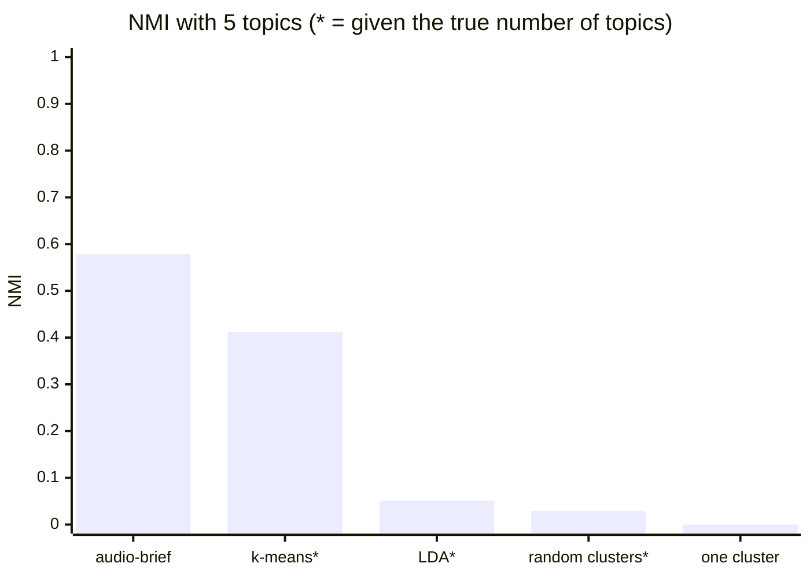
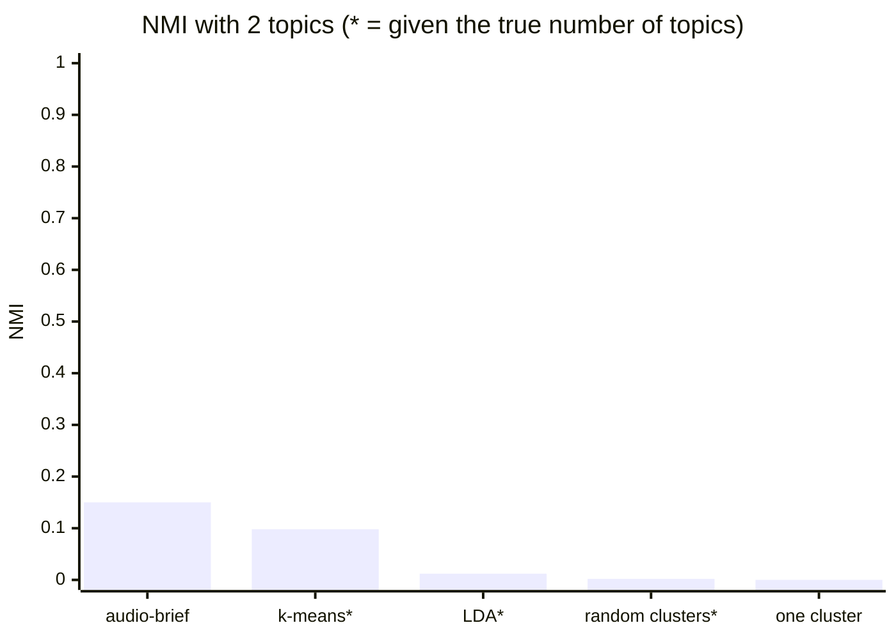
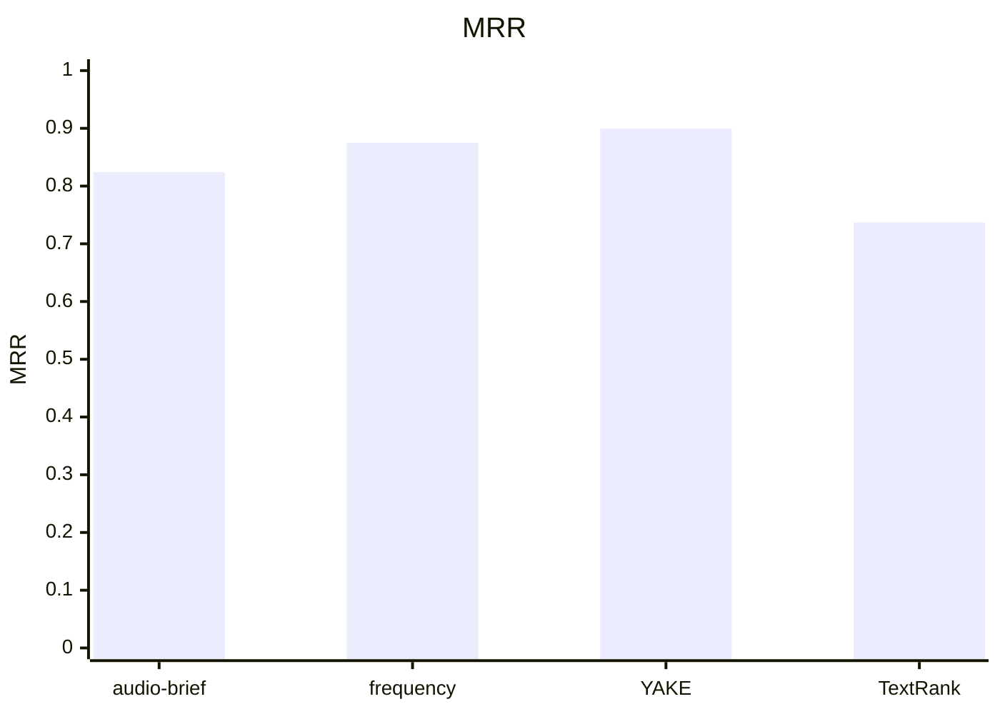
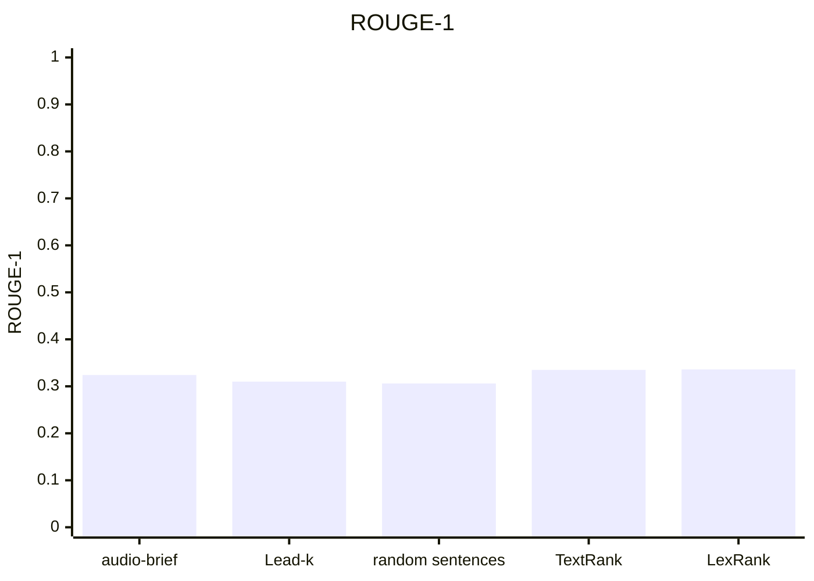
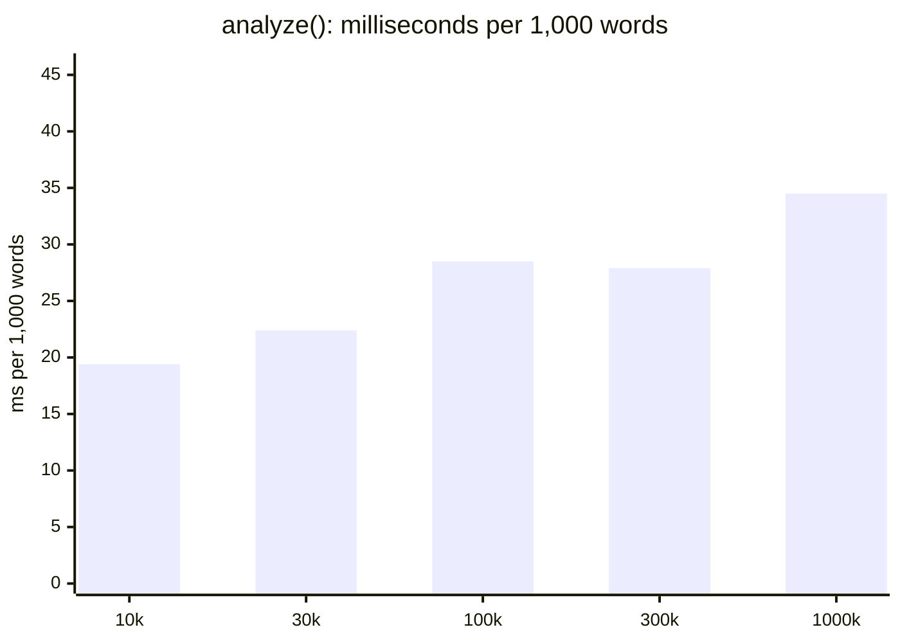
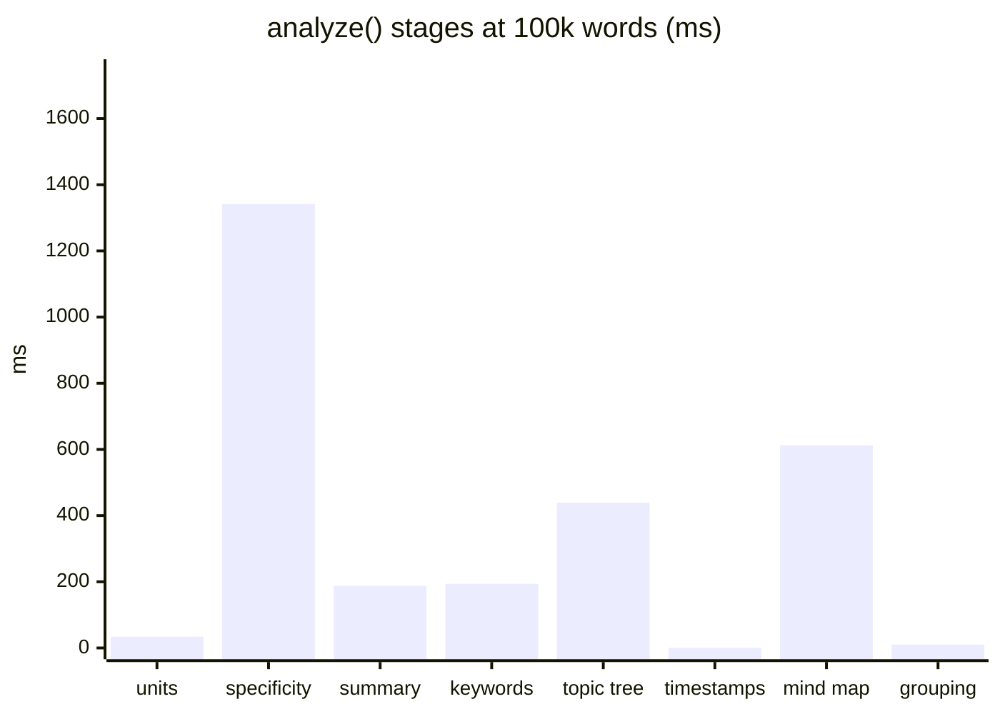
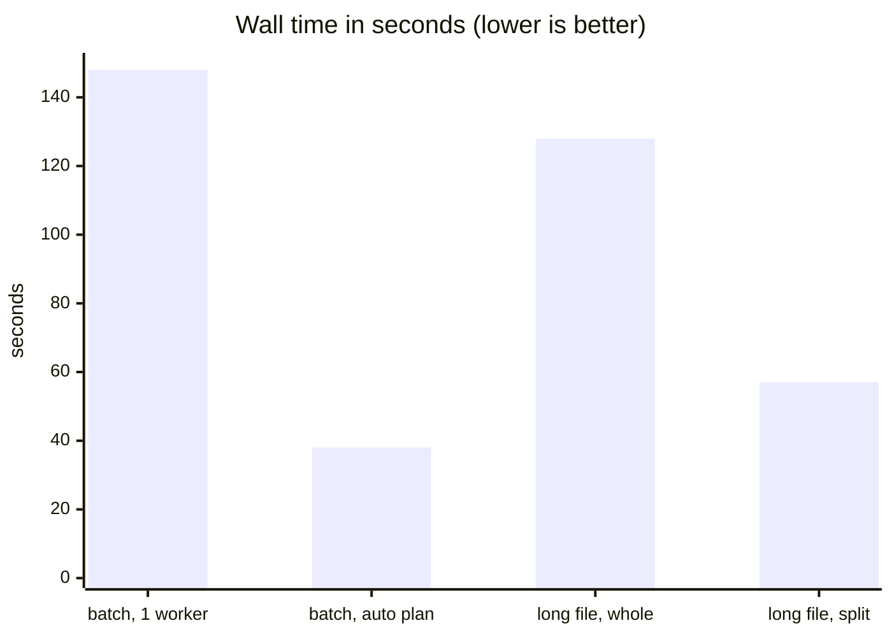

# Benchmark results

Generated 2026-11-15T22:55:00 by `make bench` (`python -m benchmarks.run`). **Do not edit by hand**; raw numbers for every trial are in [`results.json`](results.json). How and why each number is measured: [METHODOLOGY.md](METHODOLOGY.md).

Re-measured later with `--only`: parallel on 2026-11-16T00:17:00.

## Environment

| | |
|---|---|
| python | 3.12.3 |
| implementation | CPython |
| os | Linux 6.18.44-fc-v310 |
| cpu | Intel(R) Xeon(R) Processor @ 2.60GHz |
| cores | 4 |
| memory | 16 GB |
| git commit | e1f9ee4 |
| uncommitted changes in audio brief | True |

## Data

| Dataset | Records | Words | SHA-256 (prefix) | Licence |
|---|---:|---:|---|---|
| wikipedia | 106 | 403,601 | `f8cb9f62985f` | CC BY-SA 3.0 (Wikipedia contributors); redistributed in gensim's test data (LGPL-2.1 package) |
| newsgroups | 200 | 39,543 | `ac5f6ef0a02b` | 20 Newsgroups (Ken Lang, 1995), widely redistributed for research; sample from gensim's test data |
| sotu | 233 | 1,794,884 | `a0df50c6d33f` | Works of the U.S. Government (no copyright); dataset PDDL-1.0 / CC0 (@stdlib) |
| asr | 8 | 152 | `f6a3be332183` | LibriVox recordings: public domain (via PocketSphinx, BSD-2); conversation sample: distributed with pyannote.audio (MIT), origin not documented there; Silero VAD test audio (MIT package); used locally for measurement only, not redistributed |

Sources: gensim 4.4.0 source distribution (its test fixtures contain both corpora) (files.pythonhosted.org); @stdlib/datasets-sotu 0.2.3 (npm) (registry.npmjs.org); pocketsphinx 5.1.1 source distribution (LibriVox test utterances) (files.pythonhosted.org); pyannote.audio 4.0.7 source distribution (sample conversation + STM transcript) (files.pythonhosted.org); silero-vad 6.2.3 source distribution (untranscribed test/example speech) (files.pythonhosted.org). Checksums are verified before use (`benchmarks/fetch_data.py`).

How to read the tables: values are means over trials with a 95% bootstrap confidence interval in brackets. *audio-brief vs system* is the paired difference on the same trials, its 95% CI, how many trials audio-brief won/tied/lost, and a verdict that says **better** or **worse** only when the interval excludes zero.

## 1. Topic discovery in multi-topic transcripts

Does audio-brief put sentences about the same subject in the same mind-map branch? Scored with NMI and ARI (0 = chance, 1 = perfect) against the true source of every sentence; sentences audio-brief leaves out (fragments, leftovers) count as one extra cluster.

### Wikipedia mixtures

Real encyclopedia sentences from k random articles, 40 consecutive sentences each, interleaved in blocks of 2-8 so every subject comes back several times.

**3 topics** · 20 trials · median 2,578 words per transcript

| System | NMI, mean [95% CI] | ARI, mean [95% CI] | audio-brief vs system, NMI diff [95% CI] · wins/ties/losses |
|---|---|---|---|
| audio-brief | 0.527 [0.498, 0.557] | 0.486 [0.442, 0.529] | — |
| TF-IDF + k-means (true k) | 0.409 [0.367, 0.449] | 0.269 [0.226, 0.313] | +0.118 [0.078, 0.161] · 17/0/3 · **better** |
| LDA (true k) | 0.036 [0.024, 0.050] | 0.022 [0.009, 0.036] | +0.491 [0.458, 0.526] · 20/0/0 · **better** |
| random clusters (true k) | 0.018 [0.013, 0.023] | 0.003 [-0.002, 0.008] | +0.509 [0.479, 0.541] · 20/0/0 · **better** |
| one cluster | 0.000 [0.000, 0.000] | 0.000 [0.000, 0.000] | +0.527 [0.498, 0.557] · 20/0/0 · **better** |

**5 topics** · 20 trials · median 4,388 words per transcript

| System | NMI, mean [95% CI] | ARI, mean [95% CI] | audio-brief vs system, NMI diff [95% CI] · wins/ties/losses |
|---|---|---|---|
| audio-brief | 0.578 [0.545, 0.614] | 0.505 [0.463, 0.550] | — |
| TF-IDF + k-means (true k) | 0.412 [0.369, 0.454] | 0.200 [0.159, 0.242] | +0.166 [0.131, 0.202] · 20/0/0 · **better** |
| LDA (true k) | 0.051 [0.042, 0.062] | 0.021 [0.013, 0.031] | +0.527 [0.493, 0.564] · 20/0/0 · **better** |
| random clusters (true k) | 0.029 [0.024, 0.034] | 0.002 [-0.002, 0.007] | +0.550 [0.515, 0.588] · 20/0/0 · **better** |
| one cluster | 0.000 [0.000, 0.000] | 0.000 [0.000, 0.000] | +0.578 [0.545, 0.614] · 20/0/0 · **better** |

**8 topics** · 20 trials · median 7,086 words per transcript

| System | NMI, mean [95% CI] | ARI, mean [95% CI] | audio-brief vs system, NMI diff [95% CI] · wins/ties/losses |
|---|---|---|---|
| audio-brief | 0.560 [0.533, 0.588] | 0.410 [0.382, 0.439] | — |
| TF-IDF + k-means (true k) | 0.410 [0.381, 0.440] | 0.147 [0.127, 0.169] | +0.150 [0.119, 0.180] · 20/0/0 · **better** |
| LDA (true k) | 0.067 [0.061, 0.074] | 0.018 [0.014, 0.021] | +0.493 [0.465, 0.521] · 20/0/0 · **better** |
| random clusters (true k) | 0.041 [0.037, 0.045] | 0.001 [-0.001, 0.003] | +0.519 [0.489, 0.549] · 20/0/0 · **better** |
| one cluster | 0.000 [0.000, 0.000] | 0.000 [0.000, 0.000] | +0.560 [0.533, 0.588] · 20/0/0 · **better** |



### Usenet threads

Real posts from alt.atheism and sci.space (20 Newsgroups), 40 per transcript, in blocks of 1-3 posts: informal, conversational text.

**2 topics** · 20 trials · median 8,124 words per transcript

| System | NMI, mean [95% CI] | ARI, mean [95% CI] | audio-brief vs system, NMI diff [95% CI] · wins/ties/losses |
|---|---|---|---|
| audio-brief | 0.150 [0.140, 0.158] | 0.055 [0.047, 0.063] | — |
| TF-IDF + k-means (true k) | 0.098 [0.077, 0.120] | -0.013 [-0.034, 0.010] | +0.052 [0.028, 0.075] · 15/0/5 · **better** |
| LDA (true k) | 0.012 [0.007, 0.016] | 0.012 [0.006, 0.019] | +0.138 [0.128, 0.147] · 20/0/0 · **better** |
| random clusters (true k) | 0.002 [0.001, 0.003] | 0.000 [-0.001, 0.002] | +0.148 [0.138, 0.156] · 20/0/0 · **better** |
| one cluster | 0.000 [0.000, 0.000] | 0.000 [0.000, 0.000] | +0.150 [0.140, 0.158] · 20/0/0 · **better** |



## 2. Topic tree quality

Measured on the same transcripts. Reference topic words are those mentioned in ≥ 3 sentences, ≥ 80% of them from one source.

| Transcripts | Topics found (coverage) | Purity | Generic top-level topics | Top-level topics per real topic | Sentences placed in a topic branch | Mind-map branches |
|---|---|---|---|---|---|---|
| Wikipedia, 3 topics | 100% [100%, 100%] | 86% [78%, 95%] | 0% [0%, 0%] | 1.483 [1.350, 1.633] | 86% [85%, 88%] | 6 (median) |
| Wikipedia, 5 topics | 98% [95%, 100%] | 82% [74%, 91%] | 0% [0%, 0%] | 1.095 [1.030, 1.165] | 85% [84%, 86%] | 9 (median) |
| Wikipedia, 8 topics | 97% [94%, 99%] | 65% [58%, 71%] | 0% [0%, 0%] | 0.903 [0.860, 0.945] | 82% [81%, 83%] | 16 (median) |
| Usenet, 2 topics | 98% [92%, 100%] | 85% [79%, 90%] | 0% [0%, 0%] | 2.900 [2.600, 3.225] | 76% [75%, 77%] | 46 (median) |

## 3. Keywords

### Topical precision in multi-topic transcripts

Share of the top 15 keywords that are reference topic words, and share of topics that get at least one.

| Transcripts | System | Topical precision@15 | Topics covered@15 | audio-brief vs system, precision diff · w/t/l |
|---|---|---|---|---|
| Wikipedia, 3 topics | audio-brief | 85% [80%, 90%] | 100% [100%, 100%] | — |
| Wikipedia, 3 topics | frequency | 82% [77%, 87%] | 100% [100%, 100%] | +3% [-0%, 7%] · 10/7/3 · **no clear difference** |
| Wikipedia, 3 topics | YAKE | 89% [85%, 93%] | 100% [100%, 100%] | −4% [-9%, 1%] · 3/7/10 · **no clear difference** |
| Wikipedia, 5 topics | audio-brief | 84% [79%, 88%] | 97% [93%, 100%] | — |
| Wikipedia, 5 topics | frequency | 79% [74%, 85%] | 99% [97%, 100%] | +4% [-0%, 9%] · 10/3/7 · **no clear difference** |
| Wikipedia, 5 topics | YAKE | 88% [84%, 92%] | 90% [83%, 96%] | −4% [-9%, 0%] · 6/3/11 · **no clear difference** |
| Wikipedia, 8 topics | audio-brief | 77% [74%, 81%] | 83% [78%, 88%] | — |
| Wikipedia, 8 topics | frequency | 74% [71%, 78%] | 83% [78%, 88%] | +3% [-1%, 7%] · 9/7/4 · **no clear difference** |
| Wikipedia, 8 topics | YAKE | 86% [81%, 91%] | 81% [77%, 86%] | −9% [-13%, -4%] · 3/3/14 · **worse** |
| Usenet, 2 topics | audio-brief | 78% [73%, 83%] | 92% [82%, 100%] | — |
| Usenet, 2 topics | frequency | 80% [75%, 86%] | 80% [68%, 90%] | −2% [-7%, 2%] · 6/4/10 · **no clear difference** |
| Usenet, 2 topics | YAKE | 91% [87%, 95%] | 65% [55%, 75%] | −13% [-17%, -10%] · 0/3/17 · **worse** |

### Article subject in the top 10 keywords

38 Wikipedia articles (first 2,000 words of the body). A silver standard: the article title names its main subject, so a good extractor should rank the title words high. Words are compared after Porter stemming, for every system alike.

| System | title recall@10, mean [95% CI] | hit@10, mean [95% CI] | MRR, mean [95% CI] | audio-brief vs system (MRR) · w/t/l |
|---|---|---|---|---|
| audio-brief | 0.982 [0.956, 1.000] | 1.000 [1.000, 1.000] | 0.824 [0.725, 0.909] | — |
| frequency | 0.956 [0.908, 0.991] | 1.000 [1.000, 1.000] | 0.875 [0.789, 0.947] | −0.051 [-0.155, 0.050] · 4/24/10 · **no clear difference** |
| YAKE | 0.965 [0.921, 1.000] | 1.000 [1.000, 1.000] | 0.900 [0.821, 0.966] | −0.076 [-0.179, 0.021] · 3/24/11 · **no clear difference** |
| TextRank | 0.776 [0.662, 0.882] | 0.895 [0.789, 0.974] | 0.737 [0.610, 0.855] | +0.087 [-0.040, 0.220] · 12/20/6 · **no clear difference** |



## 4. Summaries

41 Wikipedia articles: each system summarises the body (first 3,000 words) and is scored against the article's human-written lead section with ROUGE F1 (`rouge-score`, Porter stemming). Every summary is cut to the same word budget (the lead's length, at most 150 words).

| System | ROUGE-1, mean [95% CI] | ROUGE-2, mean [95% CI] | ROUGE-L, mean [95% CI] | audio-brief vs system (ROUGE-1) · w/t/l |
|---|---|---|---|---|
| audio-brief | 0.324 [0.303, 0.345] | 0.063 [0.053, 0.073] | 0.168 [0.159, 0.178] | — |
| Lead-k | 0.310 [0.290, 0.331] | 0.059 [0.048, 0.070] | 0.162 [0.152, 0.171] | +0.014 [-0.002, 0.029] · 25/1/15 · **no clear difference** |
| random sentences | 0.306 [0.288, 0.323] | 0.051 [0.044, 0.059] | 0.159 [0.151, 0.168] | +0.019 [-0.000, 0.037] · 26/0/15 · **no clear difference** |
| TextRank | 0.335 [0.318, 0.352] | 0.069 [0.060, 0.078] | 0.170 [0.160, 0.180] | −0.011 [-0.020, -0.002] · 14/0/27 · **worse** |
| LexRank | 0.336 [0.317, 0.355] | 0.062 [0.054, 0.072] | 0.165 [0.154, 0.175] | −0.012 [-0.027, 0.002] · 16/0/25 · **no clear difference** |



## 5. Performance

Real speech transcripts: State of the Union addresses joined in chronological order and cut at each size. `analyze()` is the whole text analysis; *full export* also writes all 11 files. Each run starts with a cold term cache, like a new recording; sizes up to 100k words get one warm-up run first. Whisper transcription is not included (see Limitations).

| Words | Units | Runs | analyze(), median [IQR] | Full export, median | Throughput | Peak memory (analyze) |
|---:|---:|---:|---|---:|---:|---:|
| 10,000 | 454 | 5 | 0.19s [0.15, 0.22] | 0.23s | 51,657 words/s | 3 MB |
| 30,000 | 1,374 | 5 | 0.67s [0.57, 0.83] | 0.68s | 44,573 words/s | 10 MB |
| 100,000 | 4,536 | 3 | 2.85s [2.35, 2.89] | 2.16s | 35,036 words/s | 31 MB |
| 300,000 | 13,536 | 2 | 8.36s [8.25, 8.47] | 9.55s | 35,872 words/s | 84 MB |
| 1,000,000 | 46,659 | 1 | 34.46s [34.46, 34.46] | 33.39s | 29,020 words/s | not measured |

Fitted scaling: analysis time ∝ words^1.12 (R² = 0.999; 1.00 would be perfectly linear).



Where the time goes at 100,000 words (median of 3 runs):

| Stage | Time | Share |
|---|---:|---:|
| units | 34 ms | 1% |
| specificity | 1342 ms | 48% |
| summary | 188 ms | 7% |
| keywords | 194 ms | 7% |
| topic tree | 439 ms | 16% |
| timestamps | 0 ms | 0% |
| mind map | 612 ms | 22% |
| grouping | 10 ms | 0% |



Single recordings: 40 individual State of the Union addresses (1,372-27,708 words, median 7,006): analysis took a median of 206 ms (slowest 1280 ms).

## 6. Speech recognition

Real recorded speech: LibriVox audiobook utterances (read speech), a two-speaker telephone conversation with a time-stamped transcript, and untranscribed speech used only for speed. Word error rate (WER) = (substitutions + deletions + insertions) / reference words, after the same normalisation for every engine (lower case, no punctuation, "mr" = "mister", digits as words).

> **Small test set**: 152 transcribed words (8 files, 4.7 min of real speech in total). Word error rates have wide intervals; treat them as indicative.

| Engine | Status | WER, all [95% CI] | read speech | conversation, per turn | conversation, whole file | Speed (real-time factor) | Long file | Peak memory |
|---|---|---|---|---|---|---|---|---|
| pocketsphinx | bundled en-us model | 63% [46, 86] | 27% [20, 32] | 95% [84, 108] | 81% | 0.80 (median of 3 files) | 5 min in 220 s (RTF 0.73) | 169 MB |
| whisper tiny | **not measured**: model weights not cached and not downloadable (URLError) | | | | | | | |
| whisper base | **not measured**: model weights not cached and not downloadable (URLError) | | | | | | | |

Real-time factor = processing time / audio length (below 1 is faster than real time), one CPU process. Peak memory is the engine process's maximum resident size, model included.

Installed size: PocketSphinx 39 MB; Whisper with PyTorch 5.5 GB (as installed here).

Examples (pocketsphinx), after normalisation:

- *librivox_0870*
  - reference: and mister john dashwood had then leisure to consider how much there might be prudently in his power to do for them
  - recognised: and mister john guess would have been at leisure to consider how much there might be prickly in his power to do for
- *librivox_0880*
  - reference: he was not an ill disposed young man
  - recognised: he was not until this blows young man
- *conversation*
  - reference: hello hello oh hello i didn't know you were there neither did i okay then i thought you know i heard a beep this is diane in new jersey and i'm sheila in texas originally from chicago oh i'm originally from chicago also i'm in new jersey now though well there isn't that much differen
  - recognised: hello hello i'll highlight the night repair and he admitted that it had been i've repeated that i am in new jersey and i'm sheila and pack them in their chili who should have only one really fun to have often a major theme now the bullet and am i different to flee to know they are commie a yankee do

## 7. Parallel processing

`audio_brief/parallel.py` runs recognition in worker processes (recognition keeps Python's GIL, so threads do not help: 2 PocketSphinx threads ran 1.02x faster than one), schedules the longest work first, splits long recordings at pauses when workers would otherwise idle, and analyses finished recordings while the others are still being transcribed.

Machine: 4 CPU cores, 15.0 GB available. Engine: PocketSphinx (Whisper not measured, see section 6). Both runs of each row use the same worker-process machinery; only the plan differs.

| Work | One worker | Automatic plan | Speed-up | Word error rate |
|---|---:|---:|---:|---|
| Batch: 8 real recordings, 4.7 min of audio | 148 s | 38 s (4 workers, 10 units) | **3.9x** | 2 extra unit(s): long files were split; see the next row for what splitting does to accuracy |
| One long recording (4.6 min, fully transcribed) | 128 s (whole) | 57 s (5 parts on 4 workers) | **2.2x** | whole 60.5% vs split 57.4% (760 reference words) |

Splitting changes which words PocketSphinx outputs (29% of words differ between the whole and the split transcript: its decoding adapts over a recording), but it does not make the transcript worse against the reference. The long recording is a single file, so treat the WER comparison as indicative.



## 8. Controlled stress tests (synthetic)

Generated conversations with exact ground truth for specific failure modes (generic words shared by every topic, no punctuation, verbatim repetition). They complement the real-data results above and are not evidence of real-world quality on their own.

| Dataset | Words | Topic tree coverage | Purity | Generic top-level | Branches per topic | Keyword precision | Mind-map purity | Full export |
|---|---:|---:|---:|---:|---:|---:|---:|---:|
| meeting | 169 | 100% | 100% | 0% | 1.3 | 73% | 94% | 5 ms |
| verbatim chat 2000 | 10,642 | 100% | 86% | 0% | 0.9 | 100% | 88% | 235 ms |
| conversation 200 | 1,209 | 62% | 60% | 0% | 1.0 | 47% | 64% | 15 ms |
| conversation 2000 | 12,538 | 100% | 100% | 0% | 1.0 | 100% | 100% | 127 ms |
| conversation 8000 | 50,184 | 100% | 100% | 0% | 1.0 | 100% | 100% | 477 ms |
| conversation 2000, no punctuation | 12,538 | 100% | 100% | 0% | 1.0 | 100% | 96% | 132 ms |

## Limitations

- Text experiments use clean text: recognition errors are measured separately (section 6) and not propagated into the text results. Whisper is only measured where its weights can be downloaded or are cached; otherwise the report says so.
- Wikipedia and Usenet are written text. The multi-topic transcripts are *compositions* of real sentences (a standard method, Choi 2000), not recorded conversations.
- The Usenet sample has only two topics; the keyword *subject* test uses titles as a silver standard.
- Timings depend on the machine (see Environment); compare runs from the same machine. On the shared virtual machine that produced this file, repeated runs of the same speech-recognition measurement differed by up to about 30%; the long-file figure is a single run.

## Reproduce

```bash
make bench          # full run, writes this file and results.json
make bench-quick    # small run, printed only
```
