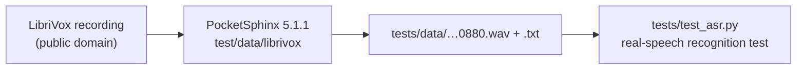

# Test data

`librivox_sense_and_sensibility_0880.wav` is 3 seconds of real read speech:
"he was not an ill disposed young man" (reference transcript in the `.txt` file
next to it), from the LibriVox recording of Jane Austen's *Sense and
Sensibility*, chapter 1. LibriVox recordings are in the public domain. This
utterance is distributed in the test data of PocketSphinx 5.1.1
(`test/data/librivox/sense_and_sensibility_01_austen_64kb-0880.wav`), where
audio-brief's copy comes from; 16 kHz, mono, 16-bit PCM.

